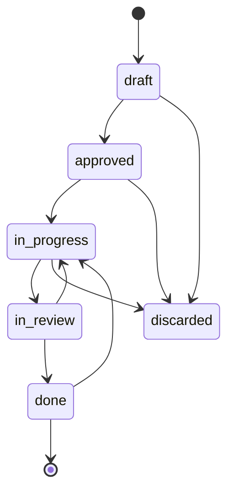

## Request

Primer change del plan de recorte registrado en `docs/changeledger-v1-plan.md`.
El ciclo de vida baja de ocho estados a seis: desaparecen `in-validation` y
`blocked`, y con ellos los comandos `validation` y `reopen`.

La aceptación humana **no se pierde**: deja de ser un estado y pasa a ser un
dato. `review pass` lleva el change a `done`, que significa «entregado»; el
merge de su rama en la rama de integración es la aceptación, y queda registrada
en el documento como dato, no como puerta. La única frontera irreversible es el
**release**: mientras el change no figure en un release registrado vuelve a
`in-progress` sin ningún comando especial.

`blocked` lo sustituye lo que ya existe: una tarea `[!]` con su razón en el Log.
La taxonomía de clases de fallo que hoy vive en `blocked.md` no se pierde: se
muda a `review.md` y pasa a cubrir también el rechazo humano.

Fuera de alcance, por pertenecer a otros changes del mismo plan: el aislamiento
de correcciones y las clases de commit, el DoR y el flag `tdd`, la reducción de
tipos, la limpieza de duplicación del contrato, las cápsulas y la revisión por
selección resuelta.

## Investigation

Medido sobre los 1.648 changes de los tres repos que usan ChangeLedger.

- **La puerta de validación hace trabajo real.** 272 rechazos humanos
  registrados: 102 en `ionic-app` sobre 61 changes, 109 en `backend-laravel`
  sobre 86, 44 aquí sobre 36. Por eso la aceptación se conserva como dato: si
  desapareciera entera, se pierde la única señal de cuántas veces el humano
  rechaza lo entregado.
- **`blocked` apenas se usa.** 81 changes pasaron por él: 4 % aquí, 7 % en
  `ionic-app`, 5 % en `backend-laravel`. Lo que sí tiene valor es su taxonomía
  de clases de fallo, introducida por `20260722-124655`.
- **Coste en contrato.** `## Lifecycle` de `core.md` son 334 palabras de 2.141;
  `validation.md` 243 y `blocked.md` 206. La auditoría clasificó las nueve
  reglas de `validation.md` como reformulaciones de invariantes que ya están en
  `core.md`.
- **Coste en tests.** Los dos estados aparecen en 13 y 17 ficheros de test.
  `metrics.mjs` los nombra en `ACTIVE` y deriva `validationWaitMs` de
  `in-validation`.
- **Documentos vivos afectados.** Ninguno en este repo. En los repos
  consumidores hay 17: 14 en `in-validation` y 3 en `blocked`. Los 1.587
  terminales no se validan (`check` omite archivados y descartados), así que el
  histórico no se toca.

## Proposal

### Solución elegida

El estado `in-validation` se sustituye por un campo. `review <id> pass` mueve
`in-review → done`. `done` significa «entregado por el agente, pendiente de que
el humano lo acepte». La aceptación se registra cuando la rama del change está
fusionada en la rama de integración.

`done → in-progress` sustituye tanto al rechazo humano de hoy como a `reopen`.
La frontera no es la aceptación sino el release: `release record <version>`
congela la membresía de una versión publicada, así que un change incluido en
`.changeledger/releases/<version>.yml` ya no puede crecer sin que esa versión
mienta sobre lo que contiene. Graduación y archivo dejan de ser fronteras —
`--into` no sobrescribe el cuerpo de la spec y el archivo es reversible
editando `archived: false`, según `close.md`.

`blocked` desaparece sin sustituto de estado: un impedimento es una tarea `[!]`
con su razón, que ya es gramática válida del Plan, más una nota en el Log.
`review fail --block` desaparece; queda `review fail`.

### Alternativas descartadas

- **Borrar la aceptación entera y confiar en el PR.** Descartada: se pierden los
  272 rechazos como señal medible, y nada garantiza que la revisión del PR
  cubra lo que cubría la validación.
- **Renombrar `in-validation` a otro estado.** Descartada: conserva el overlay,
  el presupuesto, la fila de la matriz y los comandos. El coste no baja.
- **Un comando `accept` explícito.** Descartada: es `validation pass` con otro
  nombre, y sigue dependiendo de que alguien lo escriba. Derivarlo de git lo
  hace verificable y no falsificable.
- **Mantener la aceptación como frontera.** Descartada: medido sobre los 1.290
  changes de los repos de producto, las 16 reaperturas ocurrieron todas antes de
  graduar y ninguna chocó con la regla; lo que sí es incoherente es que el
  contrato liste tres fronteras durables cuando dos son reversibles.
- **Construir una migración para los 17 documentos vivos.** Descartada: v1.0 es
  ruptura limpia y los modos de migración de `fix` se retiran en otro change.
  `check` nombra el estado retirado y el destino, y los 17 se editan a mano.

## Specification

### CR1 — El conjunto de estados pierde los dos retirados
- **Given** `.changeledger/config.yml` de este repo
- **When** se lee la clave `statuses`
- **Then** su valor es exactamente `[draft, approved, in-progress, in-review, done, discarded]`
- **And** ni `in-validation` ni `blocked` aparecen en el fichero

### CR2 — Un documento vivo en un estado retirado se rechaza con mensaje accionable
- **Given** un change no archivado con `status: in-validation`
- **When** se ejecuta `changeledger check <id>`
- **Then** sale con código distinto de cero
- **And** imprime `status "in-validation" is retired: move it to "done" or "in-progress"`
- **And** con `status: blocked` imprime `status "blocked" is retired: move it to "in-progress" and record a [!] task`

### CR3 — El histórico archivado sigue siendo válido
- **Given** los 358 changes archivados o descartados del ledger de este repo, cuyos Log contienen entradas `[validation] in-validation → done` y `[status] ... → blocked`
- **When** se ejecuta `changeledger check`
- **Then** sale con código 0
- **And** no emite ningún diagnóstico sobre esas entradas

### CR4 — `review pass` entrega a `done`
- **Given** un change en `in-review`
- **When** se ejecuta `changeledger review <id> pass`
- **Then** el frontmatter queda `status: done`
- **And** el Log recibe una entrada `[review]` con payload `in-review → done`

### CR5 — `review fail` devuelve a `in-progress` sin flags de clase
- **Given** un change en `in-review`
- **When** se ejecuta `changeledger review <id> fail "motivo"`
- **Then** el frontmatter queda `status: in-progress`
- **And** el Log recibe `[review]` con payload `in-review → in-progress: motivo`

### CR6 — `--block` y `--retry` ya no existen
- **Given** un change en `in-review`
- **When** se ejecuta `changeledger review <id> fail --block "motivo"`
- **Then** sale con código distinto de cero
- **And** imprime `error: unknown option '--block'`
- **And** el documento queda sin modificar
- **And** lo mismo ocurre con `--retry`

### CR7 — Un `done` fuera de todo release vuelve a `in-progress`
- **Given** un change en `done` que no figura en ningún fichero de `.changeledger/releases/`
- **When** se ejecuta `changeledger status <id> in-progress`
- **Then** el frontmatter queda `status: in-progress`
- **And** el Log recibe `[status]` con payload `done → in-progress`

### CR8 — Estar aceptado no cierra la vuelta
- **Given** un change en `done` con `accepted_at: 2026-10-18T10:00:00Z` que no figura en ningún release registrado
- **When** se ejecuta `changeledger status <id> in-progress`
- **Then** el frontmatter queda `status: in-progress`
- **And** el Log recibe `[status]` con payload `done → in-progress`

### CR9 — Un change publicado en un release no vuelve, por ninguna vía
- **Given** un change en `done` cuyo id figura en la lista `changes:` de un release registrado con versión `0.19.0`
- **When** se ejecuta `changeledger status <id> in-progress`
- **Then** sale con código distinto de cero
- **And** imprime `change <id> shipped in release 0.19.0: new work needs a new change`
- **And** el documento queda sin modificar
- **And** `reopen()`, la función que usa el viewer, rechaza el mismo change con el mismo mensaje

### CR21 — La frontera se lee del ledger, no del árbol de trabajo
- **Given** un repo activado, donde los releases viven en la ref de estado y `.changeledger/releases/` no existe en disco
- **When** se consulta la pertenencia a un release de un change en `done`
- **Then** la respuesta sale de los releases que expone `loadRepo`, no de `fs.readdirSync` sobre el árbol
- **And** un change publicado en ese repo activado se rechaza igual que en un repo con layout de worktree

### CR10 — La graduación sella la aceptación derivada del merge
- **Given** un change en `done` sin `accepted_at`, con una entrada `[branch]` en su Log, y esa rama fusionada en la rama publicada como `integration_branch`
- **When** se ejecuta `changeledger graduate <id> --skip "sin verdad persistente"`
- **Then** el frontmatter recibe `accepted_at` con el instante del commit de merge en ISO 8601 UTC
- **And** el Log recibe `[validation]` con payload `accepted (merged <sha-corto>)`
- **And** `changeledger graduate <id> <slug> --into` sella igual

### CR11 — Sin merge no se inventa aceptación
- **Given** un change en `done` sin `accepted_at` cuya rama no está fusionada en la rama de integración
- **When** se ejecuta `changeledger graduate <id> --skip "sin verdad persistente"`
- **Then** la graduación se registra con normalidad
- **And** el frontmatter sigue sin `accepted_at`
- **And** el Log no recibe ninguna entrada `[validation]`

### CR12 — Un change sin rama registrada gradúa igual
- **Given** un change en `done` sin `accepted_at` y sin entrada `[branch]` en su Log
- **When** se ejecuta `changeledger graduate <id> --skip "sin verdad persistente"`
- **Then** sale con código 0 y la graduación queda registrada
- **And** el frontmatter sigue sin `accepted_at`

### CR22 — `check` informa de la aceptación pendiente sin escribir
- **Given** un change en `done` sin `accepted_at` cuya rama sí está fusionada en la rama de integración
- **When** se ejecuta `changeledger check <id>`
- **Then** sale con código 0 e imprime un aviso que nombra el change y la palabra `accepted`
- **And** el documento queda byte a byte sin modificar

### CR13 — El contrato publica seis estados, una sola frontera y ningún overlay retirado
- **Given** la captura de `changeledger context`
- **When** se lee su sección de ciclo de vida
- **Then** enumera exactamente los seis estados de CR1
- **And** nombra el release como única frontera irreversible, sin mencionar graduación ni archivo como tales
- **And** no contiene las cadenas `in-validation` ni `blocked`
- **And** `templates/contract/validation.md` y `templates/contract/blocked.md` no existen

### CR14 — La taxonomía de clases de fallo sobrevive en review
- **Given** la captura de `changeledger context review`
- **When** se lee su contenido
- **Then** distingue la enumeración incompleta dentro de una estrategia ya verificada de una clase nueva de defecto
- **And** declara que esa clasificación se aplica igual a un veredicto `fail` del revisor y a un rechazo humano

### CR15 — Las métricas dejan de derivar de un estado inexistente
- **Given** un ledger con changes en los seis estados
- **When** se calculan las métricas
- **Then** `ACTIVE` de `src/metrics.mjs` es `['approved', 'in-progress', 'in-review']`
- **And** el campo `validationWaitMs` desaparece del resultado
- **And** se expone `rejectionCount`, el número de transiciones `done → in-progress` del ledger

### CR16 — El viewer no ofrece carriles ni acciones retiradas
- **Given** el viewer sirviendo este repo
- **When** se carga el tablero
- **Then** no hay carril para `in-validation` ni para `blocked`
- **And** no se renderizan los paneles de validación ni de reapertura

### CR17 — Los comandos `validation` y `reopen` ya no existen
- **Given** el repo con la CLI instalada
- **When** se ejecuta `changeledger validation 20261018-131621 pass`
- **Then** sale con código distinto de cero
- **And** imprime `error: unknown command 'validation'`
- **And** `changeledger reopen 20261018-131621 "motivo"` imprime `error: unknown command 'reopen'`
- **And** ninguno de los dos aparece en la salida de `changeledger help`

### CR18 — La plantilla de configuración no reparte estados retirados
- **Given** `templates/config.yml`, la plantilla que `changeledger init` copia a un repo nuevo
- **When** se lee su clave `statuses`
- **Then** su valor es exactamente `[draft, approved, in-progress, in-review, done, discarded]`
- **And** `changeledger init` sobre un repo vacío produce un `.changeledger/config.yml` cuya salida de `changeledger check` no menciona `in-validation` ni `blocked`

### CR19 — Un tipo sin revisión llega a `done` por la transición genérica
- **Given** un change de un tipo sin `review_required` en estado `in-progress` con todas sus tareas cerradas
- **When** se ejecuta `changeledger status <id> done`
- **Then** el frontmatter queda `status: done`
- **And** el Log recibe `[status]` con payload `in-progress → done`

### CR20 — La puerta de entrega sobrevive al cambio de sede
- **Given** un change con una tarea del Plan todavía en `[ ]`
- **When** se ejecuta `changeledger status <id> done`
- **Then** sale con código distinto de cero y el documento queda sin modificar
- **And** el mismo change en `in-review` rechaza igual `changeledger review <id> pass`

## Plan

- [x] Reducir el conjunto de estados en la configuración y rechazar los retirados en `check`
  - **Target:** `.changeledger/config.yml`, `src/check.mjs`
  - **Verify:** `node --test test/check.test.mjs`
  - **Criteria:** CR1, CR2, CR3
  - **Resolved:** `2026-10-18T15:02:09Z`
- [x] Reorientar las transiciones de `review` y retirar sus flags de clase
  - **Target:** `src/lifecycle.mjs`, `src/commands/agent.mjs`, `bin/changeledger.mjs`
  - **Verify:** `node --test test/lifecycle.test.mjs test/agent.test.mjs`
  - **Criteria:** CR4, CR5, CR6
  - **Resolved:** `2026-10-18T16:15:20Z`
- [x] Hacer del release la única frontera de la vuelta de `done` a `in-progress`
  - **Target:** `src/change.mjs`, `src/lifecycle.mjs`, `src/release.mjs`, `src/commands/agent.mjs`
  - **Verify:** `node --test test/lifecycle.test.mjs test/release.test.mjs`
  - **Criteria:** CR7, CR8, CR9, CR21
  - **Resolved:** `2026-10-19T11:25:52Z`
- [x] Detectar el merge y avisar desde `check` sin escribir
  - **Target:** `src/git.mjs`, `src/check.mjs`, `src/commands/check.mjs`
  - **Verify:** `node --test test/git.test.mjs test/check.test.mjs`
  - **Criteria:** CR22
  - **Resolved:** `2026-10-19T12:25:11Z`
- [x] Sellar `accepted_at` en la graduación
  - **Target:** `src/lifecycle.mjs`, `src/writer.mjs`, `src/commands/graduate.mjs`
  - **Verify:** `node --test test/graduate.test.mjs test/lifecycle.test.mjs test/writer.test.mjs`
  - **Criteria:** CR10, CR11, CR12
  - **Resolved:** `2026-10-19T12:51:55Z`
- [x] Retirar los comandos `validation` y `reopen`
  - **Target:** `bin/changeledger.mjs`, `src/commands/agent.mjs`
  - **Verify:** `node --test test/cli-bin.test.mjs`
  - **Criteria:** CR17
  - **Resolved:** `2026-10-18T16:15:21Z`
- [x] Sacar los estados retirados de la plantilla que reparte `init`
  - **Target:** `templates/config.yml`, `src/config-migration.mjs`
  - **Verify:** `node --test test/cli-bin.test.mjs test/config.test.mjs`
  - **Criteria:** CR18
  - **Resolved:** `2026-10-19T10:30:41Z`
- [x] Fijar con tests la arista a `done` y la puerta de entrega en sus dos sedes
  - **Target:** `test/agent.test.mjs`, `test/lifecycle.test.mjs`
  - **Verify:** `node --test test/agent.test.mjs test/lifecycle.test.mjs`
  - **Criteria:** CR19, CR20
  - **Resolved:** `2026-10-19T10:30:42Z`
- [x] Reescribir el ciclo de vida del core y borrar los dos overlays
  - **Target:** `templates/contract/core.md`, `templates/contract/validation.md`, `templates/contract/blocked.md`, `templates/contract/budgets.yml`
  - **Verify:** `node --test test/context.test.mjs`
  - **Criteria:** CR13
  - **Resolved:** `2026-10-19T13:53:54Z`
- [x] Mudar la taxonomía de clases de fallo a la revisión
  - **Target:** `templates/contract/review.md`
  - **Verify:** `node --test test/context.test.mjs`
  - **Criteria:** CR14
  - **Resolved:** `2026-10-19T13:53:55Z`
- [x] Rehacer las métricas que derivaban de `in-validation`
  - **Target:** `src/metrics.mjs`
  - **Verify:** `node --test test/metrics.test.mjs`
  - **Criteria:** CR15
  - **Resolved:** `2026-10-19T15:47:30Z`
- [ ] Retirar carriles y paneles del viewer
  - **Target:** `src/viewer/domain.mjs`, `src/viewer/public/app.js`
  - **Verify:** `node --test test/viewer-metadata.test.mjs test/view.test.mjs`
  - **Criteria:** CR16
- [ ] Barrer de la suite los casos atados a los dos estados
  - **Support:**
  - **Target:** `test/**`
  - **Verify:** `pnpm verify`

## Log
- **2026-10-18T14:44:55Z** `[version]` 0.18.0
- **2026-10-18T14:44:55Z** `[status]` draft → approved (human via conversation)
- **2026-10-18T14:45:53Z** `[status]` approved → in-progress
- **2026-10-18T14:45:53Z** `[branch]` set: feature/20261018-131621 (auto)
- **2026-10-18T15:02:09Z** `[note]` Selección 1 (CR1-CR3): statuses baja a seis en config.yml; check sustituye el mensaje genérico de estado desconocido por RETIRED_STATUS_FIXES con los dos literales accionables, y pierde las dos reglas de checkConfig que exigían in-validation antes de done y el aviso de blocked sin tarea [!]. Cuatro tests nuevos en check.test.mjs; borrado 171002 CR1/CR5 porque su regla ya no existe. Verificado por el orquestador: check.test.mjs 225/0, biome limpio, changeledger check verde. CR3 pasa porque frozenReason omite archivados y descartados — sobre el ledger real es vacuo (los 358 nunca se parsean), lo ejercita el fixture. Regresión conocida y acotada: agent.test.mjs 20261001-155216 CR10 pasa de 183/0 a 182/1 porque review pass sigue yendo a in-validation; la cierra la selección 2. Preexistente en dev y ajeno a este change: agent-prompt.test.mjs CR6 (npm pack --dry-run sin files). Residuo: check.test.mjs 2507-2580 y checkLifecycleSequence siguen apoyados en CANONICAL_STATUSES de lifecycle.mjs.
- **2026-10-18T16:15:21Z** `[note]` Selección 2 (CR4, CR5, CR6, CR17): review pass va a done y fail a in-progress sin flag de clase; --retry y --block fuera; comandos validation y reopen fuera del bin. CANONICAL_STATUSES baja a seis y TRANSITIONS se reescribe. Decisión de bordes legacy: no se amplía LEGACY_EDGES porque checkLifecycleSequence retorna antes al ver un estado fuera del conjunto canónico, así que las aristas históricas quedan toleradas por la regla que ya existía para estados personalizados; ampliarlo habría sido código inalcanzable. Verificado por el orquestador: 530/0 en lifecycle+agent+cli-bin+check, biome limpio, changeledger check y context siguen funcionando. Dos decisiones fuera del texto de los criterios, ambas correctas y ambas sin criterio que las cubriera: in-progress → done pasa a ser arista legal (sin ella los tipos sin review_required se quedaban sin ruta a done al desaparecer in-validation), y la puerta de entrega assertChangeTextValid se reinstaló en agent.mjs:320 y :410 porque vivía en validation pass. Se documentan como CR19 y CR20. Residuo con dueño nombrado: templates/config.yml sigue declarando ocho estados, así que un repo recién creado con init nace con los retirados — CR1 solo nombró .changeledger/config.yml; se cubre con CR18. validation() y reopen() siguen exportados porque src/viewer/domain.mjs los importa: se borran junto a sus llamadas en la selección de CR16. post-review sigue exigiendo in-validation y queda inalcanzable hasta el change de cápsulas. pnpm test 1995/8: cinco del viewer (CR16), dos retargets de mensaje en agent-context.test.mjs y apply.test.mjs, y agent-prompt CR6 preexistente en dev.
- **2026-10-19T10:30:42Z** `[note]` Selección 3 (CR18, CR19, CR20): templates/config.yml y CANONICAL_STATUSES de config-migration.mjs bajan a seis, así que un repo recién creado con init ya no nace con los retirados. CR19 ya estaba cubierto por el test de la arista in-progress → done de la selección 2; no se duplicó. CR20 añade dos tests sobre la puerta de entrega en sus dos sedes nuevas. Evidencia de mutación verificada por el orquestador, no sólo reportada: comentando agent.mjs:320 el test de status done falla con Missing expected exception y el de review pass sigue verde; el fichero vuelve al sha1 a6282d8e y git diff queda vacío. El orquestador cerró además tres aserciones en cascada fuera de la propiedad del delegado: cli.test.mjs bajaba a seis la lista de deepEqual, y las dos assert.match(/in-validation/) de config-migration.test.mjs pasan a doesNotMatch porque la migración ya no inserta el estado. pnpm test 1998/8, de nuevo los ocho conocidos con dueño. Residuos: config-migration nunca ELIMINA los estados retirados de un config existente, así que un repo migrado los conserva en statuses — sin criterio y con dueño en el change de ruptura limpia que borra el módulo entero; cli.test.mjs 372, 373 y 379 asertan sobre la matriz de transiciones de core.md y caerán con CR13; agent.mjs 252, 260 y 489 llaman a assertChangeTextValid y CR20 no los cubre; el comentario de review_required en templates/config.yml sigue diciendo 'before universal human validation'.
- **2026-10-19T11:25:52Z** `[note]` Selección 4 (CR7, CR8, CR9, CR21): assertNotShipped en release.mjs, pura sobre los manifiestos que recibe, nunca toca el sistema de ficheros. Dos sedes la alimentan con loadRepo(...).releases: statusMutation en la arista done → in-progress (antes de cualquier mutación en memoria, así que el rechazo deja el documento intacto, y de paso cubre el asiento de apply sin tocar ese fichero) y reopenMutation, que es la vía del viewer. Mensaje literal: change <id> shipped in release <version>: new work needs a new change. Las cuatro guardas de cierre durable (reviewed, graduación, archived, released) se reducen a una: la pertenencia a un release. Verificado por el orquestador: 229/0 en lifecycle+release+agent, pnpm test 2010/2002/8 sin fallos nuevos, biome limpio, changeledger check verde. La mutación decisiva la reproduje yo mismo: sustituyendo loadRepo(...).releases por loadReleases(repoRoot) —el lector del árbol— CR7, CR8 y CR9 siguen en verde y sólo cae CR21 (15 pass / 1 fail). Sin ese criterio la frontera no habría protegido nada en un repo activado. El delegado reescribió 150232 CR3 para fijar que reviewed, una graduación saltada y archived AHORA PERMITEN la vuelta, en vez de limitarse a borrar la regla vieja. Residuos: el asiento de status no toma el lock del historial de releases que sí toma reopen, razonado y no construido porque el layout activado cierra la ventana con el CAS de revision y reopen desaparece con CR16; el viewer sigue filtrando done → in-progress por su propio predicado eligible, así que la segunda sede de CR9 está probada a nivel de función y no de punta a punta hasta CR16; validation() sigue exportada e inalcanzable.
- **2026-10-19T12:27:15Z** `[note]` Selección 5 parcial (CR22): mergeRecord en git.mjs detecta el merge sólo con git local — refExists en ambos extremos para no colarse por un tag homónimo, merge-base --is-ancestor, y rev-list --ancestry-path --merges tomando el más antiguo como el commit que lo aterrizó; sin merge commit cae al tip de la rama. Toda incertidumbre resuelve a null: puede fallar al sellar, nunca bloquear. checkPendingAcceptance avisa con código 0 y sin escribir; el guard de frozenReason evita lanzar un subproceso git por cada uno de los 358 archivados. Verificado por el orquestador: 321/0 en los ficheros propios, pnpm test 2020/8 con los ocho conocidos, biome limpio. El delegado declaró un cruce de propiedad en src/commands/check.mjs, razonado: checkRepo es puro y lo llaman seis módulos, así que meter subprocesos git ahí habría sido peor; ninguna tarea restante apunta a ese fichero. Borró dos guardas propias que ninguna mutación mataba, y reforzó dos tests que una mutación sobrevivía. CR10-CR12 NO se han empezado: el brief del orquestador afirmaba que el tipo [validation] podía reutilizarse para el payload 'accepted (merged <sha>)' y es FALSO — su parser exige from === 'in-validation'; comprobado por el orquestador, parse devuelve null. La tarea se parte en dos y el sellado pasa a una selección propia con lifecycle.mjs, writer.mjs y graduate.mjs en propiedad. Residuo: un change trabajado directamente sobre la rama de integración se lee como fusionado en su tip, deliberado y sin criterio.
- **2026-10-19T12:51:56Z** `[note]` Selección 6 (CR10, CR11, CR12): gramática de [validation] ensanchada con ACCEPTED_PAYLOAD antes de parseTransitionPayload, conservando el arma histórica in-validation → <to> como canonicalPayload; setAcceptedAt en writer.mjs; sealAcceptance en graduate.mjs cableado en las cuatro sedes (--into activado e inactivo, --skip en ambos layouts), nunca en --new. accepted_at lleva el instante del merge y la entrada de Log el de la graduación, para que el Log quede cronológico. checkLifecycleSequence salta el arma de aceptación: sin eso el replay abandonaba la reconciliación de todos los graduados. Verificado por el orquestador: 371/0 en los ficheros propios y changeledger check verde sobre el archivo real, que es la prueba de que CR3 aguanta la gramática ensanchada. El delegado borró un try/catch propio tras descubrir, fortaleciendo el test de 'bad..branch' a 42, que requireGraduationReady ya rechaza antes y la rama era inalcanzable. Dos defectos corregidos por el orquestador: el sellado no era idempotente y close.md:28 permite varios --into por change, así que un change con tres specs recibía tres líneas accepted idénticas — guarda añadida con test y mutación probada ('one acceptance line after two graduations'); su ausencia venía de mi propio brief, que prohibía leer accepted_at sin distinguir entre puerta del ciclo e idempotencia. Y templates/contract/implement.md:89 publicaba la gramática vieja: corregida, con lo que contract.test.mjs vuelve a verde. pnpm test 2042/2034/8, los ocho conocidos. Residuos: deletePair deja línea en blanco al limpiar una clave opcional, preexistente e igual para setReviewed; metrics.mjs mapea el evento nuevo a state undefined, inofensivo hoy pero a tener en cuenta en CR15.
- **2026-10-19T13:53:55Z** `[note]` Selección 7 (CR13, CR14): core.md reescribe el ciclo a seis estados y 7 filas de matriz, nombra el release como única frontera irreversible y declara explícitamente que graduación y archivo NO lo son; validation.md y blocked.md borrados; las dos filas de STATUS_CONTEXT en commands/context.mjs retiradas. La taxonomía de clases de fallo se muda a review.md con la cláusula de CR14 de que aplica igual al fail del revisor y al rechazo humano; implement.md pasa a poseer el impedimento como tarea [!]. Verificado por el orquestador con el worktree: los cinco modos de contexto terminan en su centinela, la captura core no contiene ninguna de las dos cadenas, 225/325 líneas, 247/0 en context+contract+cli, pnpm test 2040/2032/8, biome limpio. Techo del core bajado de 4000/400 a 3250/325, lo que obligó a dos cruces de propiedad declarados en src/contract.mjs y AGENTS.md porque un invariante exige que base.core.lines sea igual al head -<n> del bootstrap. Consecuencia a decidir por el humano: los repos consumidores con head -400 serán reportados como desactualizados hasta que corran changeledger register; es el canal de deriva previsto y 400 > 325 lo hace inofensivo mientras tanto. Dato que recalibra el plan: el contrato baja de 6750 a 6322 palabras, sólo un 6%, y el core de 2141 a 2055. Retirar capacidades compra muy poca prosa; el recorte grande vive en la duplicación y las defensas caducas, que son otro change. Residuo: implement.md sigue publicando la gramática histórica de [validation] porque contract.test.mjs la asevera byte a byte contra LOG_EVENT_DEFINITIONS, y el parser la sigue aceptando por CR3; post-review sigue en la lista de roles aunque perdió su frase, y es inalcanzable hasta el change de cápsulas.
