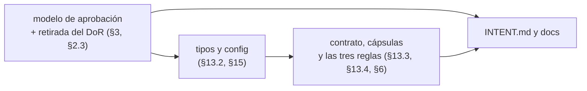

## Request

El plan `docs/changeledger-v1-plan.md` (PR 17) fija el objetivo de la v1.0: un
contrato de un tercio del peso actual, un ceremonial por change decidido por
comprensión, riesgo y reanudabilidad —nunca por tamaño ni por tipo— y la puerta
humana movida al objetivo y la frontera, con Specification y Plan escritos con
el código delante. Tras la 0.19.0 el plan está hecho en una de sus cuatro
entregas: el ciclo de vida (§13.1, changes `20261018-131621` y
`20261019-184719`). La agrupación por épica (§14.3, `20261020-172221`) entró
fuera de orden, y el recorte del contrato (`20261020-130304`) se autolimitó a
«sin decidir nada de producto», que es justo lo que el resto del recorte
necesita.

Lo medido en `dev` al cerrar la 0.19.0, frente al objetivo del plan (§1, §5,
§10):

| Medida | 0.18.0 | 0.19.0 | objetivo |
|---|---|---|---|
| contrato en disco (palabras) | 9.884 | 8.409 | ~3.590 |
| ficheros de contrato | 22 | 18 | 9 |
| `core.md`, lo que carga todo agente | 2.141 | 1.850 | ~960 |
| implementar: `core` + `implement` | 3.693 | 3.123 | ~1.460 |
| cápsulas de agente | 10 | 8 | 2 |
| tipos de change en la plantilla | 9 | 10 | 2 |
| suite de tests (LOC) | 47.369 | 51.256 | ~36.000 |

Esta épica agrupa el trabajo que falta. Sus hijos se crean a medida que el
trabajo los descubre, en el orden que las dependencias del plan dictan, y cada
uno es un change con su propia revisión.

### Objective

Terminado significa que, medido sobre `templates/contract/` y
`templates/config.yml`:

- el contrato compuesto cabe en los pesos del §5 del plan, con los techos de
  `budgets.yml` bajados a lo medido y declarados decrecientes (§7);
- el humano aprueba de un change su objetivo y su frontera, y Specification y
  Plan nacen en `in-progress` sin volver a pasar por aprobación (§3);
- el Definition of Ready y sus claves `readiness.*` no existen, y `check` no
  juzga la preparación de un draft (§2.3);
- el ceremonial lo deciden comprensión, riesgo y reanudabilidad (§15.1), y la
  revisión existe si el change toca código (§15.4), sin matriz por tipo;
- las tres reglas del §6 están en vigor: test de alcance con frontera
  pre-autorizada, `[finding]` como evento del Log con `list --pending findings`,
  y ninguna referencia al ledger fuera de `.changeledger/`;
- `INTENT.md` describe el flujo que el contrato sirve, no el anterior.

### Frontier

**Entra:** todo lo que el plan enumera en §2 (qué desaparece), §3 (modelo de
aprobación), §6 (lo que se añade), §13.2 a §13.4 (tipos y config, contrato,
cápsulas) y §15 (el criterio del ceremonial); la realineación de `INTENT.md` y
de `docs/usage-capture.md`; y la poda de los tests que prueban una capacidad
retirada o la prosa del contrato, que viaja con el hijo que retira cada una
(§9.1, filas «capacidad retirada» y «prosa del contrato»).

**Queda fuera:** el modelo de ramas y la rama de consolidación (§14.4 a §14.6);
la deuda independiente de la suite —duplicados y sintéticos, 181 casos— salvo
que la decisión 1 de abajo la meta; la release 1.0.0, que es preparación
rutinaria cuando la épica cierre; y cualquier edición en los repos consumidores.

**Pre-autorizado dentro de la frontera, sin volver a preguntar:**

- retirar un test que sólo prueba una capacidad retirada o la redacción de una
  frase del contrato, nombrándolo en el Log del hijo;
- bajar un techo de `budgets.yml` a lo medido, nunca subirlo;
- retirar una clave de `config.yml` que se queda sin lector, con ruptura limpia
  y sin migración, como el §2.3 decide;
- enmendar la Specification de un hijo en `in-progress` cuando el código
  desmienta lo planificado, registrando qué cambió y por qué en su Log; si la
  enmienda cambia el objetivo o la frontera del hijo, vuelve al humano.

### Decisiones que la épica deja al humano

Son las dos cuestiones abiertas del §11 del plan. La épica no arranca ningún
hijo que dependa de ellas hasta que estén tomadas y anotadas en este Log.

1. **La poda independiente de la suite (§11.2).** Los 181 casos duplicados y
   sintéticos no caen con ninguna capacidad retirada. Recomendación: fuera de
   esta épica. Los tests que caen con el plan ya suman dos tercios del recorte
   medido (§9.1), la deuda independiente no cambia ningún comportamiento, y
   mezclarla aquí añade superficie de revisión a hijos que ya tocan contrato,
   config y código a la vez. Un change propio, después, con la suite ya sin la
   capa de metodología, la verá más clara.
2. **La cadencia de revisión por selección resuelta (§11.4).** El plan la da
   por decidida sin dato que la respalde. Recomendación: no adoptarla en esta
   épica. Añade rondas en un plan que las quita, y el único dato medido —76 %
   de las rondas devuelven `fail`— habla de que la revisión encuentra defectos,
   no de que encontrarlos antes salga más barato. Si se quiere medir, es un
   change propio con una métrica de `analyze` por change, no una regla del
   contrato.

## Proposal

### Solución elegida

Una épica como padre, el mecanismo que `20261020-172221` construyó para esto, y
debajo un hijo por área del plan, cada uno con revisión independiente. El orden
lo fijan las dependencias que el recorte de octubre dejó escritas:

- El modelo de aprobación va primero porque el DoR es bilateral: `check` lo
  aplica en código y la prosa lo enuncia, así que retirar uno sin el otro deja
  una puerta que rechaza borradores contra una regla que ningún contexto
  publica. Hasta que caiga, el resto del contrato no baja de ~8.000 palabras.
- Tipos y config va segundo porque la existencia de la revisión deja de
  depender del tipo y pasa a depender de si el change toca código (§15.4), y
  eso es lo que sustituye a `review_required`.
- El contrato, las cápsulas y las tres reglas van juntas al final porque las
  reglas nuevas se pagan con lo que sustituyen (§6) y sólo se puede medir el
  neto con las retiradas ya hechas.

La verdad persistente la reconcilia la épica una sola vez al cerrar, como
`assertParentOwnsGraduation` impone: cada hijo resuelve su graduación con
`--skip` y la épica gradúa a `architecture.md` y a la spec del ciclo de vida lo
que el conjunto cambió.

Los hijos nacen aprobados sobre objetivo y frontera ya desde el primero, que es
el que convierte esa forma en regla del contrato: la épica aplica a sus propios
hijos el modelo que construye.

### Alternativas descartadas

- **Un solo change grande.** Viola el techo de complejidad del core y repite lo
  que las matrices de `20261021-223918` enseñaron: ocho rondas de revisión y
  deriva. Cuatro superficies —contrato, config, código, viewer— no caben en
  una pasada acotada.
- **Cuatro changes sueltos sin padre.** Es como se hizo hasta la 0.19.0 y es por
  lo que «¿qué falta del plan?» no tenía respuesta en el ledger. Además cada
  uno reconciliaría `architecture.md` por separado, cuatro veces.
- **Esperar a la 1.0.0 para publicar.** Descartado al liberar la 0.19.0: los
  consumidores reciben ya la retirada de estados, y cada hijo que rompa
  compatibilidad se acumula para un único salto de mayor al cerrar la épica.

### Escenarios

- **Un hijo descubre que el plan se equivoca contra lo que el código enseña.**
  Se enmienda dentro de la frontera pre-autorizada y queda en su Log; si lo que
  cambia es el objetivo o la frontera del hijo, se para y vuelve al humano
  antes de implementar, no después.
- **El recorte medido no alcanza el peso objetivo.** No se retira prosa
  normativa para caber en un techo (AGENTS.md): el hijo se cierra con lo que
  alcanza, el Log registra el hueco, y la épica decide con el humano si hay
  otro hijo o si el objetivo se corrige.
- **La épica cierra.** Todos los hijos están `done` o `discarded`, la épica
  reconcilia las specs, `release plan` calcula el salto de mayor con lo
  acumulado y la 1.0.0 se prepara como la 0.19.0: trabajo rutinario, sin
  change.

## Log
- **2026-10-23T18:17:33Z** `[version]` 0.18.0
