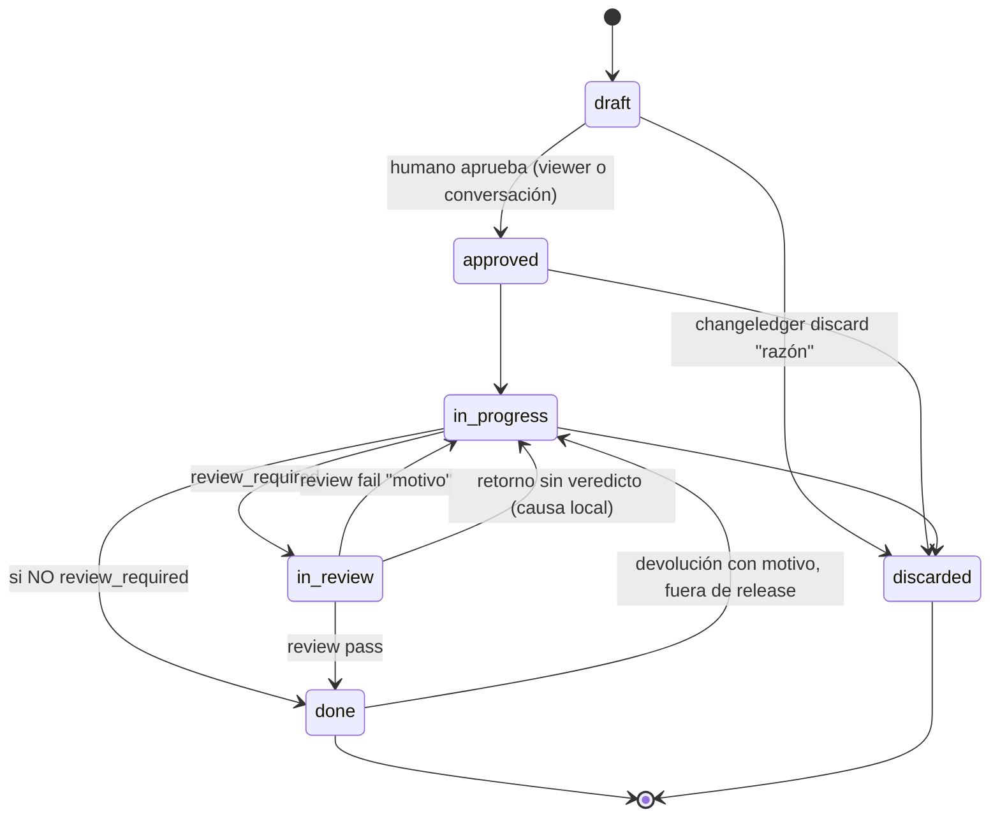

## Ciclo de vida y gate de revisión

El ciclo tiene **seis estados**: `draft`, `approved`, `in-progress`,
`in-review`, `done` y `discarded`. `done` significa **entregado por el agente**.
La aceptación humana no es un estado ni un comando: es el merge de la rama del
change en la rama de integración. La graduación sella ese instante como
`accepted_at`, que es telemetría y no condiciona ninguna transición.

**Un release registrado es la única frontera irreversible.** Mientras el change
no figure en la lista `changes:` de un fichero de `.changeledger/releases/`,
`done` vuelve a `in-progress` sin comando especial. Graduación y archivo
explícitamente **no** son fronteras: `--into` no sobrescribe el cuerpo de la
spec y el archivo se deshace editando `archived: false`. Un change ya publicado
rechaza la vuelta con `change <id> shipped in release <version>: new work needs
a new change`, y la pertenencia se lee de los releases que expone `loadRepo`, no
del árbol de trabajo, así que la respuesta es la misma en un repo activado que
en uno con layout de worktree.

**Un impedimento no es un estado**: se registra como tarea `[!]` del Plan con su
razón, y se resuelve dentro del alcance autorizado o se consulta al humano.

**Descartar.** `discarded` es un estado **terminal** alternativo a `done`: el
change se decidió no hacer. Se alcanza desde cualquier estado activo no terminal
(`draft`, `approved`, `in-progress`) con `changeledger discard <id> "<razón>"`
—la razón es obligatoria y se registra en el Log—. Preferirlo a borrar el
archivo: la decisión y su porqué siguen siendo verdad, y las referencias
`depends_on` se mantienen resolubles. El visor lo oculta por defecto (toggle
"Discarded") y nunca le da columna. `changeledger status` rechaza `discarded` para forzar
el verbo con razón; tampoco es alcanzable desde el visor.

El gate opcional **`in-review`** cierra el lazo doc↔código para los tipos que
requieren una **revisión independiente**. La revisión la
ejecuta un **subagente con contexto limpio** (sin el historial de implementación,
para no heredar sesgo) y un **modelo acorde a la dificultad**. *Qué* valida:
cada `CRn` cumplido, sin residuo y, cuando el tipo activa `plan`, Plan realmente
hecho. La
auditoría profunda de seguridad/lint/SAST queda en herramientas dedicadas que el
revisor puede invocar; ChangeLedger no las reimplementa. El *cómo* se lanza el
subagente es del agente anfitrión — `changeledger context review` solo fija el qué.

Cada review tiene un **mandato declarado antes de delegar** — *spot check* del
diff nombrado, la superficie que el change gobierna, o auditoría completa — que
el orquestador registra como nota de Log del change (`changeledger log`) y
entrega ya relleno en el prompt: el revisor inspecciona dentro del mandato y
reporta lo que note fuera de él sin ampliar la inspección. La cápsula
`agent-prompt review` porta el campo, y la checklist de la cápsula de contexto
(`agent-context review`) es **condicional al mandato**: bajo auditoría completa
—o sin mandato declarado, el default fail-safe— aplica la inspección completa;
bajo mandato más estrecho, el alcance declarado es la inspección, con el mismo
rigor.

El estado revisado es el estado entregable, y **el gate local decide si existe un
candidato revisable**: el agente anfitrión aplica el formatter y ejecuta los gates
completos **antes** de `changeledger status <id> in-review`, nunca después. Los
tipos sin review pasan el mismo gate antes de su transición directa a
`done`. Si el gate falla, el change no se movió, así que no hay historia
de review que deshacer; y si hubiera que retornar desde `in-review` por una causa
local, la vía es `changeledger status <id> in-progress` —el retorno **sin
veredicto**—, nunca `review fail`, que registraría un veredicto que ningún
revisor emitió y contaminaría Log y métricas.

La transición a `in-review` **rechaza un candidato cuya readiness es inválida**:
valida el documento tal como está, antes del cambio de status, y nombra cada
defecto encontrado sin dejar rastro en el documento. Validar el texto posterior al
cambio exoneraría al propio candidato bajo juicio, porque los defectos de readiness
solo son errores mientras el change es previo a la revisión. El alcance es la
readiness del documento, no los invariantes de repositorio.

Como el veredicto vuelve a mutar status y Log, antes del commit o del handoff se
reaplica el formatter y se repiten los checks afectados, incluido
`changeledger check`; si el candidato cambia otra vez antes de que el revisor lo
vea, se repite toda verificación afectada. El núcleo no ejecuta hooks, formatters
ni comandos externos configurables como efecto lateral; esos gates pertenecen al
repositorio anfitrión.

**Inspección post-review.** `changeledger agent-context post-review <id>` entrega
una cápsula autocontenida y estrictamente read-only —el change, sus criterios y
una frontera explícita de no mutación sobre archivos, Git y ledger— cuyo
delegado devuelve hallazgos y evidencia, nunca un veredicto que mueva el
lifecycle. El rol se llama `post-review`, no `audit`, y sin alias de
compatibilidad: `audit` es además un **tipo** de change configurado, y compartir
la cadena en dos espacios de nombres sin relación hacía que el error de puerta
del rol se leyera como un fallo del tipo. Su puerta sigue exigiendo el estado
`in-validation`, retirado del ciclo, de modo que **hoy ningún change la
satisface y el rol es inalcanzable**; reasentarlo pertenece al trabajo de
cápsulas. El contexto `review` conserva su restricción a `in-review` y su receta
de veredicto única.

El contrato canónico permite delegar cualquier etapa a subagentes cuando reduce
presión de contexto, baja coste con un modelo suficiente, paraleliza trabajo
realmente independiente o aporta revisión de contexto limpio. La delegación no es
un requisito universal ni un mecanismo prescrito por ChangeLedger: el agente
principal decide según el harness disponible. Sí es una decisión auditable: cada
delegación debe tener motivo, ownership o pregunta clara, salida esperada y
criterio de integración; los roles que escriben declaran además el baseline
esperado (rama o commit) que el delegado verifica antes de tocar su worktree. El contrato desaconseja sobrefragmentar (por archivo,
por línea o por edición mecánica diminuta), exige disjunción para trabajo en
paralelo y pide ajustar el modelo a la dificultad: modelos fuertes para
ambigüedad, arquitectura, seguridad o revisiones difíciles; modelos suficientes y
baratos para exploración localizada, inventarios, edición mecánica, tests y
verificaciones acotadas.

**Activación por tipo.** `config.yml` marca `review_required: true` por tipo
(`feature`, `bug`, `hotfix`, `refactor` y `documentation` por defecto). `chore`,
`audit` y `quick` saltan la revisión: van directos de
`in-progress` a `done` por la transición genérica. `done` significa lo mismo
para todos los tipos —entregado por el agente—, y la aceptación llega después,
con el merge.

Exigir revisión y no poder contener nada verificable es una configuración
incoherente, no una preferencia: los bloques `### CRn` sólo se parsean de
`## Specification`, de modo que un tipo con `review_required: true` sin ella
manda al revisor un encargo sin criterios que comprobar. Con el `tdd` efectivo
del tipo encendido, las tareas que citan esos criterios viven en `## Plan` y la
cobertura las ata, así que se exigen las dos stages (`REVIEWABLE_STAGES`); con
el `tdd` efectivo apagado no hay cobertura y los criterios solos son el encargo
del revisor, así que basta `specification`. `checkConfig` (`src/check.mjs`,
resolviendo el `tdd` con `effectiveTdd`) rechaza la incoherencia nombrando el
tipo y las stages ausentes en orden canónico
(`config type "<t>": review_required: true requires active stages: <faltantes>`).
Por eso `refactor` activa `specification`: es
el tipo con más probabilidad de cambiar comportamiento en silencio, y sus
criterios son la prueba de que se preservó; el trabajo mecánico pertenece a
`chore` o `quick`. Queda pendiente una incoherencia menor y conocida: `chore`
activa `plan` sin `specification`, así que sus tareas no reciben diagnósticos de
trazabilidad — pérdida de trazabilidad, no revisor mal dirigido, porque `chore`
no exige revisión.

**Carril `quick`.** Tipo oficial para trabajo pequeño trazable que antes acababa
en bypass silencioso: un solo concern, reversible, sin ampliar superficie
pública ni verdad persistente (`specs/`). Stages activos solo `## Request` y
`## Log` (documento objetivo ~10-15 líneas), sin Specification, Plan ni review
gate, pero con el ciclo corto completo (`draft → approved` humano →
`in-progress → done`) y las mismas reglas de rama y marcador
`[#id]`. Si el alcance crece durante la ejecución, se descarta y se recrea con
el tipo correcto. Su graduación es siempre `--skip`: por elegibilidad no
produce verdad persistente.

**Tipo `documentation`.** Tipo oficial cuyo entregable es verdad persistente
sobre un tema, contrastada con lo que el código hace realmente, sin tocar código
de la aplicación. La plantilla de `init` (`templates/config.yml`) lo declara con
stages `request`, `investigation`, `specification` y `log`, `review_required:
true`, `tdd: false`, `seed_stage: investigation` e impacto de release `none`. Sin Plan, sus criterios son el
encargo completo: recorre `draft → approved` humano → `in-progress → in-review →
done` sin ninguna tarea. Como no hay Plan donde poner las
obligaciones de ejecución, el contrato (`templates/contract/spec.md`) manda
redactarlas como CR propios del change: perímetro fijado en el draft según quién
llama a qué y no por coincidencias de texto, cita de ruta y símbolo en cada
afirmación, decisión humana de cada divergencia con una spec existente antes de
`in-review` —mientras falte, el change espera en una tarea `[!]`— y correcciones
de specs existentes redactadas dentro del change, donde el revisor las ve. Ninguna
migración de esquema lo añade: un repo ya existente lo declara en su config si
lo quiere.

**Tipo `hotfix`.** Tipo oficial para corregir código ya publicado: su rama parte
de la rama de release y se integra en ella. La plantilla de `init`
(`templates/config.yml`) lo declara justo después de `bug`, con sus mismas
stages (`request`, `investigation`, `specification`, `plan` y `log`),
`review_required: true`, `integrates_into: release` e impacto de release
`patch`; ninguna migración de esquema lo añade. La elección entre `bug` y un
tipo de release se liga al papel del tipo, no a su nombre: cuando el agente
clasifica un problema como defecto y la línea `Effective policy:` publica
`release_types=`, el contrato (`templates/contract/spec.md`) manda preguntar
explícitamente al humano si es un fix normal (`bug`, a la rama de integración) o
de uno de esos tipos (a la rama de release), sin inferir la respuesta y sin crear
el draft hasta tenerla; sin `release_types=` no pregunta ni propone un tipo de
release. Es una regla de contrato: nada impide mecánicamente crear un `bug` sin
preguntar.

**Ownership operacional.** El core compuesto publica una única matriz de
transición → propietario → mecanismo. Distingue la única decisión human-owned
del ciclo (`draft → approved`), los movimientos del agente —incluida la entrega
directa de un tipo sin revisión—, los dos veredictos que registra el
orquestador mediante `changeledger review`, la vuelta `done → in-progress` que
pueden tomar tanto el agente como el humano, y el descarte con razón; evita que
esa autoridad se infiera de prosa o de un diagrama paralelo.

La aprobación admite dos superficies confiadas: el viewer y una instrucción
explícita en la conversación activa que identifique inequívocamente el change.
El agente transmite esta última con `changeledger approve <id>`. El rechazo de
trabajo entregado se transmite con `changeledger status <id> in-progress
"<razón>" --human`, o desde el detalle del viewer. Elogios, “continúa”,
silencio o una recomendación del agente no autorizan estos comandos. No se
persisten conversaciones ni se añaden tokens de confirmación.

`--human` atribuye **esa única arista** y nada más: aplicado a cualquier otro
destino se rechaza nombrando `changeledger approve <id>`, porque aceptarlo allí
entregaría al agente el asiento de aprobación humana que la guarda de destinos
existe para negarle.

**Invariantes de transición.** El grafo del ciclo vive en `src/lifecycle.mjs` y
es la **única autoridad**, compartida por `changeledger status` y el visor.
`lifecycle.assertTransition(from, to, { type, reviewRequired })` valida el grafo
completo (no solo el gate) y `agent.status()` lo invoca antes de escribir, así que
el CLI rechaza saltos, regresiones y no-ops
(`change is already "X"`), y el gate (`in-progress → done` bajo
`review_required` → mensaje accionable). Entre statuses no canónicos degrada a
validación por enum.

El gate es simétrico: además del salto, el grafo prohíbe la **entrada** a
`in-review` a los tipos que no declaran `review_required`. Sin esa mitad, un tipo
ligero podía entrar en revisión y la cápsula exigía al revisor comprobar `CRn` y
tareas que su documento no puede contener — el origen mecánico de que los
revisores acabaran opinando sobre diseño. Cerrarla en el grafo, y no filtrando en
los consumidores del contexto, es lo que hace el estado inalcanzable en vez de
tapado: sin `in-review` no hay estado desde el que pedir la cápsula. Cuando el
tipo del documento no se conoce, la transición se rechaza nombrando esa causa
(`cannot decide review entry: the change declares no type`) en vez de
interpolar un hueco: lo que no se puede decidir aborta y se nombra. La validación
de la secuencia registrada en el Log sigue siendo insensible al tipo, así que
ninguna historia ya escrita se invalida retroactivamente.

`in-review → done` es arista legal del grafo porque `review pass` la recorre,
así que la **vía genérica se estrecha donde el origen se conoce**: la propia
transformación de `status` rechaza ese par nombrando `changeledger review <id>
pass`. Al vivir en la transformación y no en una guarda pre-texto —que no puede
leer el estado actual— cubre por construcción sus tres sedes: el CLI, el viewer
y el batch de `apply`. Sin ella un agente entregaría sin veredicto su propio
trabajo `review_required` y `check` no vería nada mal.

`discarded` es terminal. `done` vuelve a `in-progress` por acción humana o del
agente, con motivo, salvo que el change figure en un release registrado: esa es
la única comprobación previa a la escritura, y un rechazo deja el documento byte
a byte intacto. `reviewed: true`, una graduación saltada y `archived: true` ya
no cierran la vuelta.

El visor añade la política de actor: ofrece exactamente `draft → approved` y la
devolución `done → in-progress` de un change no publicado, con razón
obligatoria; cualquier otro par recibe 403. El viewer no reimplementa la
frontera de release —delega en la misma transformación de `status` que usa el
CLI— ni ofrece asiento de aceptación, porque la aceptación es el merge.

El Log distingue el canal y el actor. La aprobación conversacional queda como
`status: draft → approved (human via conversation)`. La vuelta de `done` estampa
quién la tomó: `status: done → in-progress (human): <razón>` o
`(agent): <razón>`. La distinción es la que separa un rechazo —la única señal
que queda de insatisfacción humana— de una segunda pasada del propio agente.

**Veredicto (`changeledger review`, en `agent.review()`).** Dos desenlaces y
ninguna variante de clase: `pass` → `done` (entrega) y `fail "<motivo>"` →
`in-progress`. Exige estar en `in-review`, `fail` exige motivo, y cada veredicto
deja un marker inglés en el Log (`review → …`). El `pass` aplica además la misma
puerta de entrega que la vía sin revisión, sobre el texto ya volcado a `done`.
`in-review` cuenta como WIP en métricas.
Confirmar la corrección de un `fail` exige **volver con
`changeledger status <id> in-review` antes de delegar al revisor fresco**: la
transición re-valida el candidato y el rol de review no carga en ningún otro
status — el arco de vuelta es el mismo `in_progress --> in_review` del diagrama.
**Una review de confirmación falla solo por el defecto nombrado sin cerrar o
por una regresión que la corrección introdujo**; lo latente o adyacente que
encuentre se reporta como follow-up y lo juzga el orquestador, sin tumbar la
ronda.

**Todo fallo diagnosticado se clasifica antes de corregirse** — el veredicto
`fail` del revisor y el rechazo humano de lo entregado por igual. La taxonomía
tiene sede única en el contexto de revisión
(`templates/contract/review.md`): enumeración incompleta dentro de una
estrategia ya verificada →
corrección normal barriendo la clase, sin que el número de rondas cierre el
camino mientras la clase se sostenga; clase nueva de defecto → parar y decidir
con el humano entre salidas ilustradas como no exhaustivas (rediseño en el
mismo alcance, extensión con re-aprobación, partición, descarte). No hay
contador ni mecanismo: la clasificación es prosa del contrato y decisión
registrada en el Log.

**Un change en implementación activa por worktree.** Entregar no es esperar: un
change en `done` no retiene la cola, porque su aceptación no es un paso que
alguien deba ejecutar. El agente implementa un solo change a la vez aunque otro
ya entregado siga en `done`, y el seleccionado sigue las reglas normales de
rama, baseline, commits y aislamiento de correcciones. `changeledger context
<id>` resuelve el status de cada dependencia directa en una línea, de modo que
la cadena `depends_on` se recorre de un salto en otro sin un comando nuevo.

**Triage de fricción y autorización.** Antes de entregar al humano un resultado
completado o detenido ante un impedimento, el agente clasifica la fricción ya
descubierta. Si es
necesaria para cumplir el objetivo autorizado de un change activo, la incorpora
a su Specification/Plan/Log. Si amplía materialmente el comportamiento observable,
aunque esté relacionada, pide autorización antes de incorporarla. Si es un paso
operativo (verificar, commitear, graduar, archivar o cerrar), lo ejecuta o registra
allí: no crea un chore. Si es independiente, propone al humano tipo, título y
motivo y espera autorización antes de crear el `draft`. Lo demasiado vago se
menciona sin crear archivos. Al alcanzar `done`, comparte además una retrospectiva
breve del ciclo; `discarded` no implica un ciclo de implementación completado.

**Fronteras de commit.** Git conserva evidencia significativa y el Log conserva
la granularidad temporal. Al iniciar, `approved → in-progress` se commitea como
baseline con el documento aprobado antes del código. Cada unidad de
implementación agrupa código, tests y verdad del ledger relacionada; la
transición a `in-review` puede acompañar la última unidad. Un movimiento que solo
cambia status y Log no exige commit propio: se agrupa con el commit sustantivo
más cercano. El cierre coalesce en un único commit final la entrega pendiente
en el ledger, la graduación o el skip y la edición durable de spec; si no queda
estado de ciclo pendiente, la graduación o el skip son por sí mismos la
evidencia del cierre. Un handoff real entre sesión,
agente o worktree puede persistir todo el estado pendiente en un único
checkpoint justificado, nunca en un commit por transición. Las correcciones no
confirmadas tras review o rechazo humano conservan las reglas de aislamiento del
worktree hasta superar su gate.

## Intención y ejecución

El contrato separa intención y ejecución. Antes de crear un change permite
conversación e investigación de solo lectura, pero exige conjuntamente claridad
suficiente y autorización humana explícita; una petición directa de creación ya
autoriza, sin permitir que el agente invente requisitos faltantes. El humano
autoriza alcance, aprueba drafts y acepta resultados; el agente divide y ejecuta
el trabajo dentro de ese alcance.

## Log y owner/branch

El `## Log` es el **ledger del ciclo de vida**, ortogonal a las etapas de
contenido del tipo: registra cada transición de `status` con su timestamp y se
crea automáticamente al primer cambio de estado aunque el tipo no lo declare
(p.ej. `chore`).

**Validación secuencial.** `changeledger check` reproduce los eventos del Log
desde `draft` contra el grafo de `src/lifecycle.mjs` mediante el parser
compartido `parseLogEvent` (líneas `status: from → to` con origen explícito;
`review → …` con origen implícito `in-review`).
Son **errores**: una transición cuyo origen no coincide con el estado
reconstruido (p.ej. un veredicto `review → done` duplicado), self-loops,
aristas fuera del grafo y un `status` final incompatible con la secuencia. Dos
compatibilidades **acotadas** mantienen legible el historial anterior sin
relajar el grafo para trabajo nuevo: las aristas legacy literales
(`in-review → done`, `in-progress → done`, `draft → in-progress`, de las que
sólo la última sigue fuera del grafo canónico) y el *resync*
de huecos tempranos — solo un origen explícito `status:` puede adelantar la
reconstrucción, solo hacia delante y solo entre `draft`/`approved`/`in-progress`;
los orígenes implícitos de review exigen siempre la secuencia exacta.
Statuses no canónicos desactivan la validación del change (el grafo no modela
esos estados), y de ahí que el histórico siga siendo válido: cualquier evento
que toque un estado retirado aborta el replay de ese change en vez de
convertirse en error.

El tipo de evento `[validation]` sobrevive con dos armas. La histórica,
`in-validation → <to>`, debe seguir parseando o cada aceptación del archivo se
convertiría en un diagnóstico de evento inválido. La viva,
`accepted (merged <sha>)`, es la que estampa la graduación; como no declara
origen, el replay la **salta** explícitamente en vez de leerla como un estado
no modelable, que abandonaría la reconstrucción de todo change graduado. El `owner` nace en la creación (`changeledger new`): se resuelve
la identidad git local vía `ownerHandle` salvo que se pase `--owner` explícito,
que siempre prevalece. `ownerHandle` prueba primero el username de GitHub (`gh
api user --jq .login`), con fallback a `git config user.name` si `gh` falta o
no está autenticado; tolerante (vacío si ninguno, sin fallar la creación — el
change simplemente nace sin `owner`). Si un change llega a `in-progress` sin
owner —creado en CI o en un entorno sin identidad resoluble—, `changeledger
status` lo autoasigna con la misma resolución como red de seguridad; nunca pisa
un owner ya fijado, a mano (`changeledger owner`) o desde la creación, y la
resolución es perezosa: con owner ya fijado no se lanza ningún subproceso. El
runner por defecto de `gh` respeta el kill-switch `CHANGELEDGER_NO_GH` (retorno
vacío antes de cualquier exec); los scripts `test` y `verify` lo fijan, así que
la suite es hermética por construcción — ningún test alcanza la red por esta
vía aunque no inyecte resolver. Los scripts usan una asignación de entorno
inline y el workspace de pnpm habilita `shellEmulator`, por lo que ese
kill-switch se aplica también cuando pnpm ejecuta la suite en Windows. El
script `test` lanza `node --test` a través de `scripts/run-tests.mjs`, que da a
cada ejecución una raíz temporal propia (`TMPDIR`, `TEMP` y `TMP`) y la borra
cuando la suite termina o falla y, en POSIX, tras SIGINT, SIGTERM, SIGHUP o
SIGQUIT; un SIGKILL del envoltorio la deja atrás. En Windows no hay señales
POSIX: Ctrl+C normalmente entrega SIGINT y cerrar la consola SIGHUP, mientras
que `subprocess.kill()` con SIGINT, SIGTERM, SIGHUP o SIGQUIT termina el
envoltorio sin ejecutar sus manejadores, como un SIGKILL; por eso las pruebas de
señales del envoltorio se saltan en Windows. Ctrl+Break (SIGBREAK) no tiene
manejador, y la limpieza tras un Ctrl+C real o un cierre de consola en Windows
no se ha ejecutado. Un runner
inyectado puentea el kill-switch, de
modo que los tests de la propia resolución no cambian de comportamiento.

El `branch` es opcional y, a diferencia de `owner`, no tiene equivalente en
`changeledger new`: al crear el draft normalmente no existe todavía una rama de
trabajo, así que solo se autoasigna al entrar en `in-progress`, capturando la
rama real del checkout que ejecuta la transición (`checkoutBranch`, tolerante:
vacío en detached HEAD o si el subproceso git falla, sin bloquear la
transición). Mismo guard que `owner`: nunca pisa un `branch` ya fijado, a mano
(`changeledger branch <id> <name>`, con `changeledger branch <id> -` para
limpiarlo) o desde una transición previa a `in-progress`, y la resolución es
perezosa. No hay detección automática de rename; corregir el campo tras una
mudanza es responsabilidad del comando explícito, y la discrepancia se hace
visible en las transiciones (ver abajo). `branch` no impone ningún formato de nombre: registra el nombre real
de la rama tal cual está, sin normalizarlo ni validarlo contra un patrón —
distinto de `git.change_branch_format` (`20260731-161655`), que sí exige un
formato exacto y bloquea `approved → in-progress` si no se cumple.
La discrepancia entre el checkout real y el `branch` registrado se reporta
como un aviso no bloqueante en toda transición agent-owned (`20260808-141944`):
nunca bloquea la transición ni reescribe el campo.

## Graduación

El cierre de trabajo entregado reconcilia la verdad durable antes de archivar. Si
una o más specs existentes gobiernan la capacidad modificada, se revisan todas:
primero se corrigen o eliminan afirmaciones obsoletas o contradictorias y después
se integra la verdad actual. Una spec nueva se crea únicamente cuando ninguna
existente posee esa verdad; `--skip` se reserva para cambios que no alteran verdad
persistente. Cada spec creada o modificada se enlaza individualmente con
`graduate --into` antes del archivo.

**Sellado de la aceptación.** Los modos que escriben (`--into` y `--skip`, nunca
`--new`) sellan de paso la aceptación derivada del merge: si el change no lleva
ya `accepted_at` y la rama que registra su propia entrada `[branch]` —no el
checkout— está fusionada en la rama de integración, el frontmatter recibe
`accepted_at` con el instante del commit de merge en ISO 8601 UTC y el Log una
entrada `[validation] accepted (merged <sha-corto>)` fechada en la graduación,
para que el Log quede cronológico. Es **telemetría, nunca una puerta**: toda
incertidumbre de git resuelve a nulo, así que la graduación puede fallar al
sellar pero nunca falla por el sellado. Sin merge no se inventa aceptación y sin
entrada `[branch]` la graduación procede igual. El sellado es idempotente: un
change que enlaza varias specs con varios `--into` recibe una sola línea de
aceptación. `changeledger check <id>` avisa —código 0, sin escribir— de un
`done` fusionado al que todavía le falta el sello.

**Revisión de la reconciliación.** En un tipo con `review_required`, cuando el
cierre crea, corrige o amplía specs, el orquestador delega el rol `graduation-review`
una vez redactada la reconciliación y antes del primer `--into`
(`templates/contract/close.md`); ante hallazgos corrige la redacción y delega de
nuevo a un revisor nuevo, y registra el resultado con `changeledger log <id>`.
`--skip` no la requiere. Es una obligación del contrato: ni `graduate` ni
`check` comprueban que se haya hecho. `changeledger agent-context
graduation-review <id>` solo carga sobre un change `done` (`ALLOWED_STATUSES`,
`src/commands/agent-context.mjs`) y entrega una cápsula estrictamente read-only:
el delegado contrasta el diff de cada spec afectada, tomado del origen que nombra
su prompt (el journal de estado en un repo activado, el worktree en uno
inactivo), con el código que cita y con el change aceptado; comprueba las reglas
de spec —verdad actual sin cronología, ningún CR como estructura, cada
cuantificador universal cumplido en el código o acotado, lo eliminado obsoleto y
nada de lo que el change hizo verdad ausente— y devuelve hallazgos con evidencia
y una única recomendación: aplicar o corregir. No cambia el status, no añade
entradas al Log ni nombra comandos de lifecycle o graduación.

Los identificadores de criterios pertenecen al change y no forman parte de la
estructura durable. Tanto `changeledger check` como `graduate --into` rechazan
headings Markdown, incluidos Setext y headings anidados, cuyo texto comienza con
`CR` seguido de dígitos fuera de bloques de código. Las menciones en prosa y los
ejemplos dentro de código permanecen permitidos.

**Resolución de graduación.** Tras `done`, cada change se resuelve: gradúa a un spec
o registra un skip (bug/chore sin verdad persistente). La finalización con
`--into` y el skip fijan `reviewed: true` (`writer.setReviewed`);
`changeledger list --pending graduation` lista los `done` con `reviewed !==
true`. `changeledger graduate <id> --skip [razón]`
(`skipGraduation`, solo en `done`) deja `graduation skipped` en el Log sin crear
una spec. "Graduado a spec" sigue siendo derivable de la marca `graduado a spec`
del Log — `reviewed` solo registra que la pregunta quedó zanjada. `check` valida
que `reviewed`, si está, sea booleano; no avisa de pendientes (es bajo demanda).
Los tres modos que escriben (`--new`, `--into`, `--skip`) ejecutan primero el
mismo check scoped del change `done`. Si existen tareas incompletas o errores de
secuencia/formato, fallan antes de crear una spec, refrescar `updated`, añadir el
marker de graduación o fijar `reviewed: true`.

`changeledger list --pending archive [--owner NAME|--unowned]` previsualiza los
changes `done`, `reviewed: true`, no archivados y con resolución de graduación en
`## Log` (`graduado a spec` o `graduation skipped`). `changeledger archive
--graduated` acepta el mismo filtro opcional y archiva exactamente el conjunto
previsualizado; sin filtro conserva el alcance global. Escribe `archived: true`
más una entrada `archived` en el Log y no toca estados activos,
descartados, changes sin reviewed ni changes ya archivados. Una graduación
múltiple se acota con `list --pending graduation --owner NAME`, pero cada id se
resuelve individualmente con `--new`, `--into` o `--skip`.

La intención es siempre explícita y los modos `--new`, `--into` y `--skip` son
mutuamente excluyentes. Un slug posicional sin modo falla sin
escribir, por lo que `skip` o `skip-*` nunca pueden convertirse accidentalmente
en nombres de spec.

Para una spec nueva, `--new` llama a `scaffoldSpec()`: crea una semilla desde
la fase que el tipo del change declara en `types.<tipo>.seed_stage` o, si no la
declara, desde Specification y, a falta de ella, Proposal. `checkConfig` exige
que `seed_stage` sea texto (`seed_stage must be a string`), una de las stages
activas del tipo (`seed_stage "<s>" is not an active stage`) y una fase que
pueda sembrar una spec: `investigation`, `proposal` o `specification`
(`config type "<t>": seed_stage "<s>" cannot seed a spec; use one of:
investigation, proposal, specification`); `request`, `plan` y `log` se
rechazan. Cada tipo recibe a lo sumo uno de esos errores, en ese orden. La
semilla lleva
un marcador explícito de scaffold, pero no escribe el
Log ni fija `reviewed`; el change continúa pendiente. El agente reemplaza la
semilla por verdad actual durable y elimina el marcador. Después `--into`
(`graduate(..., { into: true })`) exige que la spec exista y que el marcador ya
no esté, refresca `updated` (`writer.setSpecUpdated`), deja intacto el cuerpo y
registra el vínculo más `reviewed: true`. Para una spec ya existente, el agente
edita primero su cuerpo y usa directamente `--into`.

La finalización `--into` mantiene bloqueada la spec desde su lectura hasta que
termina la escritura del change o su compensación. Si el reemplazo atómico del
change falla antes de confirmarse, restaura byte a byte la spec original bajo el
mismo lock; si el change ya fue reemplazado y falla únicamente el cleanup, no
deshace una graduación confirmada. Si también falla la restauración, propaga un
`AggregateError` que conserva en orden tanto la causa original como la del
rollback.
