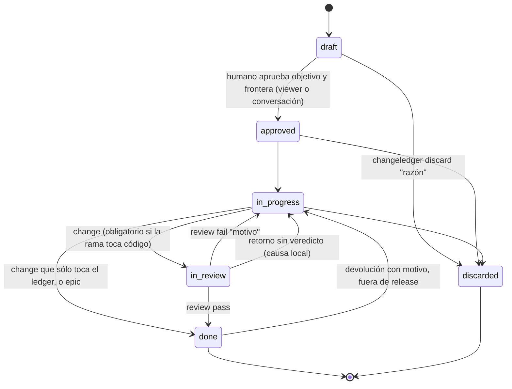

## Ciclo de vida y gate de revisión

El ciclo tiene **seis estados**: `draft`, `approved`, `in-progress`,
`in-review`, `done` y `discarded`. `done` significa **entregado por el agente**.
La aceptación humana no es un estado ni un comando: es el merge de la rama del
change en la rama de integración. La graduación sella ese instante como
`accepted_at`, y `sync` sella después el que la graduación no alcanzó; es
telemetría y no condiciona ninguna transición.

**Un release registrado es la única frontera irreversible.** Mientras el change
no figure en la lista `changes:` de un fichero de `.changeledger/releases/`,
`done` vuelve a `in-progress` sin comando especial. Graduación y archivo
explícitamente **no** son fronteras: `--into` no sobrescribe el cuerpo de la
spec y el archivo se deshace editando `archived: false`. Un change ya publicado
rechaza la vuelta con `change <id> shipped in release <version>: new work needs
a new change`, y la pertenencia se lee de los releases que expone `loadRepo`, no
del árbol de trabajo, así que la respuesta es la misma en un repo activado que
en uno con layout de worktree.

**Un impedimento no es un estado**: se registra como tarea `[!]` del Plan con su
razón, y se resuelve dentro del alcance autorizado o se consulta al humano.

**Descartar.** `discarded` es un estado **terminal** alternativo a `done`: el
change se decidió no hacer. Se alcanza desde cualquier estado activo no terminal
(`draft`, `approved`, `in-progress`) con `changeledger discard <id> "<razón>"`
—la razón es obligatoria y se registra en el Log—. Preferirlo a borrar el
archivo: la decisión y su porqué siguen siendo verdad, y las referencias
`depends_on` se mantienen resolubles. El visor lo oculta por defecto (toggle
"Discarded") y nunca le da columna. `changeledger status` rechaza `discarded` para forzar
el verbo con razón; tampoco es alcanzable desde el visor.

El gate **`in-review`** cierra el lazo doc↔código con una **revisión
independiente** para todo `change` cuya rama toca código fuera del ledger. La revisión la
ejecuta un **subagente con contexto limpio** (sin el historial de implementación,
para no heredar sesgo) y un **modelo acorde a la dificultad**. *Qué* valida:
el comportamiento que declara la Specification contra el diff y los tests que lo
prueban, cada tarea del Plan realmente hecha, sin residuo y sin deriva del
objetivo y la frontera aprobados; no busca ids de criterio en el código. La
auditoría profunda de seguridad/lint/SAST queda en herramientas dedicadas que el
revisor puede invocar; ChangeLedger no las reimplementa. El *cómo* se lanza el
subagente es del agente anfitrión — `changeledger context review` solo fija el qué.

Cada review tiene un **mandato declarado antes de delegar** — *spot check* del
diff nombrado, la superficie que el change gobierna, o auditoría completa — que
el orquestador registra como nota de Log del change (`changeledger log`) y
entrega ya relleno en el prompt: el revisor inspecciona dentro del mandato y
reporta lo que note fuera de él sin ampliar la inspección. La cápsula
`agent-prompt review` porta el campo, y la checklist de la cápsula de contexto
(`agent-context review`) es **condicional al mandato**: bajo auditoría completa
—o sin mandato declarado, el default fail-safe— aplica la inspección completa;
bajo mandato más estrecho, el alcance declarado es la inspección, con el mismo
rigor.

El estado revisado es el estado entregable, y **el gate local decide si existe un
candidato revisable**: el agente anfitrión aplica el formatter y ejecuta los gates
completos **antes** de `changeledger status <id> in-review`, nunca después. Un
change que no toca código pasa el mismo gate antes de su transición directa a
`done`. Si el gate falla, el change no se movió, así que no hay historia
de review que deshacer; y si hubiera que retornar desde `in-review` por una causa
local, la vía es `changeledger status <id> in-progress` —el retorno **sin
veredicto**—, nunca `review fail`, que registraría un veredicto que ningún
revisor emitió y contaminaría Log y métricas.

La transición a `in-review` **exige un candidato revisable** (`assertReviewable`,
`src/check.mjs`): `## Specification` y `## Plan` presentes y con cuerpo, y al
menos un `### CRn` en la Specification; si no, rechaza con `cannot request
review: …` nombrando lo ausente, lo vacío o `"## Specification" declares no
criterion`. Después valida el documento tal como está, antes del cambio de
status, con la validación scoped de `check`, y nombra cada defecto encontrado sin
dejar rastro en el documento. El alcance es el documento, no los invariantes de
repositorio.

Como el veredicto vuelve a mutar status y Log, antes del commit o del handoff se
reaplica el formatter y se repiten los checks afectados, incluido
`changeledger check`; si el candidato cambia otra vez antes de que el revisor lo
vea, se repite toda verificación afectada. El núcleo no ejecuta hooks, formatters
ni comandos externos configurables como efecto lateral; esos gates pertenecen al
repositorio anfitrión.

**Rol delegado.** Hay uno solo, `review` (`AGENT_ROLES`,
`src/commands/agent-context.mjs`), de sólo lectura. Cualquier otro nombre,
incluido un rol retirado, se rechaza con `Unknown role "<rol>" — valid roles:
review` y nunca vuelve a resolver, ni siquiera como alias. El contexto `review`
conserva su restricción a `in-review` y su receta de veredicto única.

El contrato canónico permite delegar cualquier etapa a subagentes cuando reduce
presión de contexto, baja coste con un modelo suficiente, paraleliza trabajo
realmente independiente o aporta revisión de contexto limpio. La delegación no es
un requisito universal ni un mecanismo prescrito por ChangeLedger: el agente
principal decide según el harness disponible. Sí es una decisión auditable, de un
solo nivel: la sección `## Delegation` del core manda que cada prompt declare por
qué se delega, su objetivo y su frontera, los ficheros que posee, para un rol que
escribe el baseline que verifica primero, el comando que verifica su resultado,
el formato de vuelta y que no delega de nuevo; una review se delega desde el
esqueleto `changeledger agent-prompt review`. El contrato desaconseja sobrefragmentar (por archivo,
por línea o por edición mecánica diminuta), exige disjunción para trabajo en
paralelo y pide ajustar el modelo a la dificultad: modelos fuertes para
ambigüedad, arquitectura, seguridad o revisiones difíciles; modelos suficientes y
baratos para exploración localizada, inventarios, edición mecánica, tests y
verificaciones acotadas.

**Ruta de entrega.** La decide git, no el tipo. Un `change` va de `in-progress`
a `done` directamente sólo si su rama no toca nada fuera del ledger
(`changes_dir`, `specs_dir` y `.changeledger/`): ni en el rango que introduce
sobre su rama de integración ni en las rutas sin commitear del worktree que la
tiene en checkout (`assertTouchesOnlyLedger`, `src/commands/agent.mjs`). Si toca
código, el rechazo nombra la ruta revisada (`change <id> touches code outside
the ledger …: move it to in-review and record a verdict`), y el change se entrega
con `in-review` y `review pass`. Toda duda —sin rama registrada ni derivable,
una rama que git no tiene, commits propios ya fusionados, git que falla— cierra
igual, nombrando su causa (`cannot decide whether change <id> touches code: …`),
porque la vía directa se salta la revisión independiente. Un `change` siempre
puede entrar en `in-review`, toque código o no. `done` significa lo mismo para
todos —entregado por el agente—, y la aceptación llega después, con el merge.

**Tipos y ceremonial.** Hay dos tipos, fijos en código como los seis estados
(`CHANGE_TYPES`, `src/change.mjs`): `change` implementa y `epic` agrupa sin
implementar. Las etapas canónicas son cuatro, `Request`, `Specification`, `Plan`
y `Log`, en ese orden (`CANONICAL_STAGES`); ningún tipo activa una etapa y
ninguna clave de configuración las declara: un change lleva las que necesita.
Investigation y Proposal son prosa libre bajo `###`: dentro del Request lo que
ayuda al humano a aprobar, dentro de la Specification lo que se encuentra con el
código delante. El ceremonial lo deciden comprensión, riesgo y reanudabilidad,
nunca el tamaño (`templates/contract/spec.md`). Un `epic` no lleva Specification
ni Plan —`check` las rechaza en él—, nunca entra en `in-review` (`epic changes do
not enter review — move to done instead`) y entrega desde `in-progress` sin
consultar git.

`tdd` es una política global de la configuración (por defecto `true`) sin
anulación por tipo: un change declara `tdd: false` en su frontmatter cuando no
entrega comportamiento que un test pueda ejercitar, y su Log dice por qué. El
valor efectivo tiene una sede, `effectiveTdd` (`src/check.mjs`): el `tdd` del
change si es booleano, si no el global, si no `true`; lo publica la línea
`Effective policy:` como `tdd=on|off`, que un `epic` no lleva. El impacto de
release es también del change: `release_impact` en su frontmatter, si no
`release.default_impact` de la configuración, si no `patch`; un `epic` pesa
siempre `none`.

Un change que documenta un tema contra el código redacta sus reglas de ejecución
como CR propios (`templates/contract/spec.md`): perímetro fijado en el draft
según quién llama a qué y no por coincidencias de texto, cita de ruta y símbolo
en cada afirmación, decisión humana de cada divergencia con una spec existente
antes de `in-review` o `done` —mientras falte, el change espera en una tarea
`[!]`— y correcciones de specs existentes redactadas dentro del change.

**Integración en la rama de release.** Un change cuya rama parte de la rama de
release y se integra en ella lo declara con `integrates_into: release` en su
frontmatter. Cuando el agente clasifica un problema como defecto y la línea
`Effective policy:` publica `release_branch=`, el contrato
(`templates/contract/spec.md`) manda preguntar explícitamente al humano si el fix
se integra en la rama de integración o en la de release, sin inferir la
respuesta y sin crear el draft hasta tenerla; sin `release_branch=` no pregunta
ni declara `integrates_into`. Es una regla de contrato: nada impide
mecánicamente crear el change sin preguntar.

**Ownership operacional.** El core compuesto publica una única matriz de
transición → propietario → mecanismo. Distingue la única decisión human-owned
del ciclo (`draft → approved`), los movimientos del agente —incluida la entrega
directa sin revisión—, los dos veredictos que registra el
orquestador mediante `changeledger review`, la vuelta `done → in-progress` que
pueden tomar tanto el agente como el humano, y el descarte con razón; evita que
esa autoridad se infiera de prosa o de un diagrama paralelo.

**Qué se aprueba.** El humano aprueba de un draft, de cualquiera de los dos
tipos, exactamente dos cosas bajo `## Request`: el `### Objective` —qué problema
se resuelve y qué significa terminado— y la `### Frontier` —qué superficie
entra, qué queda fuera y qué queda pre-autorizado dentro—. La sede `approved` de
`statusMutation`, que comparten `approve` y el viewer, valida el texto previo
con la validación scoped y exige después ambas subsecciones con cuerpo
(`assertApprovable`, `src/check.mjs`): sin ellas rechaza con `cannot approve:
"## Request" is missing|is empty`, `cannot approve: "### Frontier" is missing` o
`cannot approve: "### Objective", "### Frontier" are empty`, y deja el documento
byte a byte intacto; ninguna otra etapa necesita cuerpo. `changeledger new`
siembra ambas subsecciones. Specification y Plan se escriben en `in-progress`
con el código delante, se reescriben según mejora la comprensión, con el Log
diciendo por qué, y nunca vuelven a aprobación: la puerta que los exige es la
entrada a `in-review`. La regla de alcance (`templates/contract/core.md`): entra
lo que tiene que ser cierto para cumplir el objetivo aprobado y sale lo que, sin
hacerse, deja el objetivo cumplido; la frontera puede pre-autorizar trabajo
dentro de ella, y cambiar el objetivo o la frontera vuelve al humano.

La aprobación admite dos superficies confiadas: el viewer y una instrucción
explícita en la conversación activa que identifique inequívocamente el change.
El agente transmite esta última con `changeledger approve <id>`. El rechazo de
trabajo entregado se transmite con `changeledger status <id> in-progress
"<razón>" --human`, o desde el detalle del viewer. Elogios, “continúa”,
silencio o una recomendación del agente no autorizan estos comandos. No se
persisten conversaciones ni se añaden tokens de confirmación.

`--human` atribuye **esa única arista** y nada más: aplicado a cualquier otro
destino se rechaza nombrando `changeledger approve <id>`, porque aceptarlo allí
entregaría al agente el asiento de aprobación humana que la guarda de destinos
existe para negarle.

**Invariantes de transición.** El grafo del ciclo vive en `src/lifecycle.mjs` y
es la **única autoridad**, compartida por `changeledger status` y el visor.
`lifecycle.assertTransition(from, to, { kind, touchesCode })` valida el grafo
completo (no solo el gate) y `agent.status()` lo invoca antes de escribir, así que
el CLI rechaza saltos, regresiones y no-ops
(`change is already "X"`), y el gate (`in-progress → done` de un `change` sin
`touchesCode: false` establecido por git → mensaje accionable que nombra
`in-review`). Un `kind` distinto de `change` o `epic` se rechaza. Entre statuses
no canónicos degrada a validación por enum.

El gate es simétrico: además del salto, el grafo prohíbe la **entrada** a
`in-review` a un `epic`, que no lleva criterios ni tareas que revisar. Cerrarla
en el grafo, y no filtrando en los consumidores del contexto, es lo que hace el
estado inalcanzable en vez de tapado: sin `in-review` no hay estado desde el que
pedir la cápsula. Lo que git no puede decidir aborta y se nombra, en vez de
interpolar un hueco. La validación de la secuencia registrada en el Log sigue
siendo insensible al tipo, así que ninguna historia ya escrita se invalida
retroactivamente.

`in-review → done` es arista legal del grafo porque `review pass` la recorre,
así que la **vía genérica se estrecha donde el origen se conoce**: la propia
transformación de `status` rechaza ese par nombrando `changeledger review <id>
pass`. Al vivir en la transformación y no en una guarda pre-texto —que no puede
leer el estado actual— cubre por construcción las tres sedes que transforman: el
CLI, el viewer y el batch de `apply`. El documento editado a mano es una cuarta
vía, que ninguna transformación alcanza, y la cierra una pasada propia de
`check` descrita en la spec de validación.

`discarded` es terminal. `done` vuelve a `in-progress` por acción humana o del
agente, con motivo, salvo que el change figure en un release registrado: esa es
la única comprobación previa a la escritura, y un rechazo deja el documento byte
a byte intacto. Ni `reviewed: true`, ni una graduación saltada, ni
`archived: true` cierran la vuelta.

El visor añade la política de actor: ofrece exactamente `draft → approved` y la
devolución `done → in-progress` de un change no publicado, con razón
obligatoria; cualquier otro par recibe 403. El viewer no reimplementa la
frontera de release —delega en la misma transformación de `status` que usa el
CLI— ni ofrece asiento de aceptación, porque la aceptación es el merge.

El Log distingue el canal y el actor. La aprobación conversacional queda como
`status: draft → approved (human via conversation)`. La vuelta de `done` estampa
quién la tomó: `status: done → in-progress (human): <razón>` o
`(agent): <razón>`. La distinción es la que separa un rechazo —la única señal
que queda de insatisfacción humana— de una segunda pasada del propio agente.

**Veredicto (`changeledger review`, en `agent.review()`).** Dos desenlaces y
ninguna variante de clase: `pass` → `done` (entrega) y `fail "<motivo>"` →
`in-progress`. Exige estar en `in-review`, `fail` exige motivo, y cada veredicto
deja un marker inglés en el Log (`review → …`). El `pass` aplica además la misma
puerta de entrega que la vía sin revisión, sobre el texto ya volcado a `done`.
`in-review` cuenta como WIP en métricas.
La corrección de un `fail` —o de un rechazo humano— es **una selección resuelta
más**: se commitea como cualquier otra y el change **vuelve con `changeledger
status <id> in-review` antes de delegar al revisor fresco**: la transición
re-valida el candidato y el rol de review no carga en ningún otro status — el
arco de vuelta es el mismo `in_progress --> in_review` del diagrama. El revisor
fresco inspecciona de nuevo `baseline..HEAD` bajo el mandato que declara el
orquestador. En la tercera ronda sobre el mismo change se para y se devuelve al
humano la elección entre re-acotar y trabajo de seguimiento; el Log ya cuenta
las rondas (`templates/contract/review.md`).

**Todo fallo diagnosticado se clasifica antes de corregirse** — el veredicto
`fail` del revisor y el rechazo humano de lo entregado por igual. La taxonomía
tiene sede única en el contexto de revisión
(`templates/contract/review.md`): enumeración incompleta dentro de una
estrategia ya verificada →
corrección normal barriendo la clase, sin que el número de rondas cierre el
camino mientras la clase se sostenga; clase nueva de defecto → parar y decidir
con el humano entre salidas ilustradas como no exhaustivas (rediseño en el
mismo alcance, extensión con re-aprobación, partición, descarte). No hay
contador ni mecanismo: la clasificación es prosa del contrato y decisión
registrada en el Log.

**Un change en implementación activa por worktree.** Entregar no es esperar: un
change en `done` no retiene la cola, porque su aceptación no es un paso que
alguien deba ejecutar. El agente implementa un solo change a la vez aunque otro
ya entregado siga en `done`, y el seleccionado sigue las reglas normales de
rama, baseline y commits. `changeledger context
<id>` resuelve el status de cada dependencia directa en una línea, de modo que
la cadena `depends_on` se recorre de un salto en otro sin un comando nuevo.

**Triage de fricción y autorización.** Antes de entregar al humano un resultado
completado o detenido ante un impedimento, el agente clasifica lo que queda
(`templates/contract/core.md`). Si es necesario para el propósito del change, va
a su Specification, Plan y Log. Si es un paso operativo (verificar, commitear,
graduar, archivar o cerrar), lo ejecuta o registra en el flujo en curso. Si cae
fuera del objetivo o la frontera aprobados, lo registra como hallazgo con
`changeledger finding <id>`, y el humano decide si se promueve. Lo demasiado
vago se menciona sin crear archivos. Tras el cierre comparte además una
retrospectiva breve del ciclo; `discarded` no implica un ciclo de implementación
completado.

**Fronteras de commit.** Git conserva evidencia significativa y el Log conserva
la granularidad temporal. Una rama de change lleva sólo cuatro clases de commit
(`templates/contract/core.md`): **Draft**, uno por documento de change, solo;
**Baseline**, exactamente uno, con el documento aprobado antes de cualquier
código; **Implementation**, uno por selección resuelta, cuando pasa su gate
local, con código, tests, tareas marcadas y Log; y **Handoff**, obligatorio ante
un impedimento o una sesión que termina sin commitear, con ese estado y su
porqué. Toda selección se commitea antes de delegar la revisión, así que el
revisor inspecciona un `baseline..HEAD` cerrado, y la última lleva además el
estado del ledger, transiciones incluidas. Una tarea del Plan o un movimiento
que solo cambia status y Log no tiene commit propio: viaja en el siguiente commit
real. El cierre coalesce en un único commit final la entrega pendiente en el
ledger, la graduación o el skip y la edición durable de spec; si no queda estado
de ciclo pendiente, la graduación o el skip son por sí mismos la evidencia del
cierre.

## Intención y ejecución

El contrato separa intención y ejecución. Antes de crear un change permite
conversación e investigación de solo lectura, pero exige conjuntamente claridad
suficiente y autorización humana explícita; una petición directa de creación ya
autoriza, sin permitir que el agente invente requisitos faltantes. El humano
autoriza alcance, aprueba el objetivo y la frontera de cada draft y acepta
resultados; el agente divide y ejecuta el trabajo dentro de ese alcance.

## Log y owner/branch

El `## Log` es el **ledger del ciclo de vida**, ortogonal a las etapas de
contenido: registra cada transición de `status` con su timestamp y se
crea automáticamente al primer cambio de estado aunque el documento no lo lleve.

**Validación secuencial.** `changeledger check` reproduce los eventos del Log
desde `draft` contra el grafo de `src/lifecycle.mjs` mediante el parser
compartido `parseLogEvent` (líneas `status: from → to` con origen explícito;
`review → …` con origen implícito `in-review`).
Son **errores**: una transición cuyo origen no coincide con el estado
reconstruido (p.ej. un veredicto `review → done` duplicado), self-loops,
aristas fuera del grafo y un `status` final incompatible con la secuencia. Dos
compatibilidades **acotadas** mantienen legible el historial anterior sin
relajar el grafo para trabajo nuevo: una sola arista legacy literal,
`draft → in-progress` —`in-review → done` e `in-progress → done` son canónicas
y no necesitan compatibilidad—, y el *resync*
de huecos tempranos — solo un origen explícito `status:` puede adelantar la
reconstrucción, solo hacia delante y solo entre `draft`/`approved`/`in-progress`;
los orígenes implícitos de review exigen siempre la secuencia exacta.
Statuses no canónicos desactivan la validación del change (el grafo no modela
esos estados), y de ahí que el histórico siga siendo válido: cualquier evento
que toque un estado retirado aborta el replay de ese change en vez de
convertirse en error. Por eso la entrega sin veredicto se comprueba en una
pasada aparte y no dentro del replay: un solo estado retirado en el Log —lo
normal en lo que quedó en vuelo tras la retirada— abandonaría la reconstrucción
antes de llegar a la línea de entrega y la dejaría pasar.

El tipo de evento `[validation]` sobrevive con dos armas. La histórica,
`in-validation → <to>`, debe seguir parseando o cada aceptación del archivo se
convertiría en un diagnóstico de evento inválido. La viva,
`accepted (merged <sha>)`, la escriben dos sedes, la graduación y `sync`; como no declara
origen, el replay la **salta** explícitamente en vez de leerla como un estado
no modelable, que abandonaría la reconstrucción de todo change graduado.

**Hallazgos.** `[finding]` es un tipo de evento del Log
(`LOG_EVENT_DEFINITIONS`, `src/lifecycle.mjs`) para lo encontrado fuera de la
frontera del change activo, con tres formas: `<texto>` abre un hallazgo,
`<n> promoted #<id>` lo enlaza al change en que se convirtió y
`<n> dropped: <razón>` lo cierra. El ordinal no se escribe en la línea abierta:
es la posición de esa línea entre las que abren hallazgo en el mismo Log (F1,
F2…), resueltos o no, y `findingsInLog` es la única lectura que lo deriva. La CLI pone el verbo delante:
`changeledger finding <id> "<texto>"`, `finding <id> promote <n> <id>` y
`finding <id> drop <n> "<razón>"`. Un texto vacío, o uno entre comillas que se
lea como resolución, se rechaza; `promote` exige un change existente distinto del
propio y no crea ninguno, y resolver un hallazgo inexistente o ya resuelto se
rechaza. `changeledger list --pending findings` lista los abiertos de todo el
ledger, archivados incluidos, por id de origen y ordinal. Ningún gate lee los
hallazgos: uno abierto no bloquea la entrega ni el archivo, y no es transición
(`analyze` no lo cuenta). `check` rechaza las resoluciones huérfanas o duplicadas
(ver la spec de validación).

El `owner` nace en la creación (`changeledger new`): se resuelve
la identidad git local vía `ownerHandle` salvo que se pase `--owner` explícito,
que siempre prevalece. `ownerHandle` prueba primero el username de GitHub (`gh
api user --jq .login`), con fallback a `git config user.name` si `gh` falta o
no está autenticado; tolerante (vacío si ninguno, sin fallar la creación — el
change simplemente nace sin `owner`). Si un change llega a `in-progress` sin
owner —creado en CI o en un entorno sin identidad resoluble—, `changeledger
status` lo autoasigna con la misma resolución como red de seguridad; nunca pisa
un owner ya fijado, a mano (`changeledger owner`) o desde la creación, y la
resolución es perezosa: con owner ya fijado no se lanza ningún subproceso. El
runner por defecto de `gh` respeta el kill-switch `CHANGELEDGER_NO_GH` (retorno
vacío antes de cualquier exec); los scripts `test` y `verify` lo fijan, así que
la suite es hermética por construcción — ningún test alcanza la red por esta
vía aunque no inyecte resolver. Los scripts usan una asignación de entorno
inline y el workspace de pnpm habilita `shellEmulator`, por lo que ese
kill-switch se aplica también cuando pnpm ejecuta la suite en Windows. El
script `test` lanza `node --test` a través de `scripts/run-tests.mjs`, que da a
cada ejecución una raíz temporal propia (`TMPDIR`, `TEMP` y `TMP`) y, dentro de
ella, un `CHANGELEDGER_HOME` desechable: `registryDir()` cae en `os.homedir()`
cuando esa variable no está, de modo que un test que llame a `init()` sin
fijarla registraría su repo temporal en el registro global real del usuario.
Fijarla en el envoltorio, y no en cada fichero de test, hace que un test nuevo
no pueda olvidarlo; un fichero que la asigne en proceso sigue ganando, porque
esa asignación ocurre dentro del hijo. El envoltorio borra la raíz —con el home
desechable dentro— cuando la suite termina o falla y, en POSIX, tras SIGINT, SIGTERM, SIGHUP o
SIGQUIT; un SIGKILL del envoltorio la deja atrás. En Windows no hay señales
POSIX: Ctrl+C normalmente entrega SIGINT y cerrar la consola SIGHUP, mientras
que `subprocess.kill()` con SIGINT, SIGTERM, SIGHUP o SIGQUIT termina el
envoltorio sin ejecutar sus manejadores, como un SIGKILL; por eso las pruebas de
señales del envoltorio se saltan en Windows. Ctrl+Break (SIGBREAK) no tiene
manejador, y la limpieza tras un Ctrl+C real o un cierre de consola en Windows
no se ha ejecutado. Un runner
inyectado puentea el kill-switch, de
modo que los tests de la propia resolución no cambian de comportamiento.

El `branch` es opcional y, a diferencia de `owner`, no tiene equivalente en
`changeledger new`: al crear el draft normalmente no existe todavía una rama de
trabajo, así que solo se autoasigna al entrar en `in-progress`, capturando la
rama real del checkout que ejecuta la transición (`checkoutBranch`, tolerante:
vacío en detached HEAD o si el subproceso git falla, sin bloquear la
transición). Mismo guard que `owner`: nunca pisa un `branch` ya fijado, a mano
(`changeledger branch <id> <name>`, con `changeledger branch <id> -` para
limpiarlo) o desde una transición previa a `in-progress`, y la resolución es
perezosa. No hay detección automática de rename; corregir el campo tras una
mudanza es responsabilidad del comando explícito, y la discrepancia se hace
visible en las transiciones (ver abajo). `branch` no impone ningún formato de nombre: registra el nombre real
de la rama tal cual está, sin normalizarlo ni validarlo contra un patrón —
distinto de `git.change_branch_format` (`20260731-161655`), que sí exige un
formato exacto y bloquea `approved → in-progress` si no se cumple.
La discrepancia entre el checkout real y el `branch` registrado se reporta
como un aviso no bloqueante en toda transición agent-owned (`20260808-141944`):
nunca bloquea la transición ni reescribe el campo.

**Cierre de una épica.** Un change con hijos —changes que lo declaran en
`parent`— no alcanza `done` mientras alguno no esté en `done` o `discarded`;
`discarded` cuenta como resuelto porque es una decisión registrada, no trabajo
pendiente. El predicado vive en un solo sitio y lo leen tres asientos: los dos
escritores de `done` (`status` y `review pass`) como guarda de fallo rápido,
que rechaza antes de mutar el documento, y `checkRepo` como **invariante de
repositorio**. Esa tercera lectura es la que hace que `apply` valide su
candidato acumulado sea cual sea el orden de las entradas, que toda ruta futura
a `done` herede la regla, y que ningún asiento de creación acepte un hijo bajo
un padre ya cerrado. Es invariante de repositorio y no diagnóstico por
documento **a propósito**: archivar la épica no retira la regla, porque archivar
oculta un documento y no resuelve el trabajo de sus hijos, y el arreglo está en
el hijo, que sigue vivo.

La graduación a spec la posee el padre: un change con `parent` sólo resuelve la
suya con `--skip`, y la reconciliación de verdad persistente del esfuerzo
completo la hace la épica.

## Graduación

El cierre de trabajo entregado reconcilia la verdad durable antes de archivar. Si
una o más specs existentes gobiernan la capacidad modificada, se revisan todas:
primero se corrigen o eliminan afirmaciones obsoletas o contradictorias y después
se integra la verdad actual. Una spec nueva se crea únicamente cuando ninguna
existente posee esa verdad; `--skip` se reserva para cambios que no alteran verdad
persistente. Cada spec creada o modificada se enlaza individualmente con
`graduate --into` antes del archivo.

**Sellado de la aceptación.** Los modos que escriben (`--into` y `--skip`, nunca
`--new`) sellan de paso la aceptación derivada del merge: si el change no lleva
ya `accepted_at` y la rama que registra su propia entrada `[branch]` —no el
checkout— está fusionada en la rama de integración, el frontmatter recibe
`accepted_at` con el instante del commit de merge en ISO 8601 UTC y el Log una
entrada `[validation] accepted (merged <sha-corto>)` fechada en la graduación,
para que el Log quede cronológico. Es **telemetría, nunca una puerta**: toda
incertidumbre de git resuelve a nulo, así que la graduación puede fallar al
sellar pero nunca falla por el sellado. Sin merge no se inventa aceptación y sin
entrada `[branch]` la graduación procede igual. El sellado es idempotente: un
change que enlaza varias specs con varios `--into` recibe una sola línea de
aceptación.

La graduación consulta el merge en su propio instante y no lo reintenta, así
que una rama que aterriza después dejaría `accepted_at` sin estampar para
siempre. El segundo asiento es `changeledger sync`, el único comando que corre
para el ledger entero y no para avanzar un change concreto. Sella por encima de
la puerta de activación, de modo que también escribe en un repo en layout de
worktree sin ref de estado, y en un repo sin remoto, porque la detección del
merge sólo lee refs locales. Dos exclusiones: `--status`, que por definición no
escribe, y un checkout que tiene la ref de estado sin haberla adoptado, donde
el worktree y la ref son dos candidatos a sede de la escritura. Alcanza a los
archivados, porque en el caso para el que existe el merge aterriza después del
archivo. `changeledger check <id>` avisa —código 0, sin escribir— de un `done`
fusionado al que todavía le falta el sello, archivado o no, y el aviso nombra a
`sync`, que es la sede capaz de limpiarlo.

**Revisión de la reconciliación.** Ningún delegado revisa la reconciliación de
specs: la revisa el humano al fusionar la rama del change
(`templates/contract/close.md`), y ni `graduate` ni `check` la juzgan.

Los identificadores de criterios pertenecen al change y no forman parte de la
estructura durable. Tanto `changeledger check` como `graduate --into` rechazan
headings Markdown, incluidos Setext y headings anidados, cuyo texto comienza con
`CR` seguido de dígitos fuera de bloques de código. Las menciones en prosa y los
ejemplos dentro de código permanecen permitidos.

**Resolución de graduación.** Tras `done`, cada change se resuelve: gradúa a un spec
o registra un skip (un change que no altera verdad persistente). La finalización con
`--into` y el skip fijan `reviewed: true` (`writer.setReviewed`);
`changeledger list --pending graduation` lista los `done` con `reviewed !==
true`. `changeledger graduate <id> --skip [razón]`
(`skipGraduation`, solo en `done`) deja `graduation skipped` en el Log sin crear
una spec. "Graduado a spec" sigue siendo derivable de la marca `graduado a spec`
del Log — `reviewed` solo registra que la pregunta quedó zanjada. `check` valida
que `reviewed`, si está, sea booleano; no avisa de pendientes (es bajo demanda).
Los tres modos que escriben (`--new`, `--into`, `--skip`) ejecutan primero el
mismo check scoped del change `done`. Si existen tareas incompletas o errores de
secuencia/formato, fallan antes de crear una spec, refrescar `updated`, añadir el
marker de graduación o fijar `reviewed: true`.

`changeledger list --pending archive [--owner NAME|--unowned]` previsualiza los
changes `done`, `reviewed: true`, no archivados y con resolución de graduación en
`## Log` (`graduado a spec` o `graduation skipped`). `changeledger archive
--graduated` acepta el mismo filtro opcional y archiva exactamente el conjunto
previsualizado; sin filtro conserva el alcance global. Escribe `archived: true`
más una entrada `archived` en el Log y no toca estados activos,
descartados, changes sin reviewed ni changes ya archivados. Una graduación
múltiple se acota con `list --pending graduation --owner NAME`, pero cada id se
resuelve individualmente con `--new`, `--into` o `--skip`.

La intención es siempre explícita y los modos `--new`, `--into` y `--skip` son
mutuamente excluyentes. Un slug posicional sin modo falla sin
escribir, por lo que `skip` o `skip-*` nunca pueden convertirse accidentalmente
en nombres de spec.

Para una spec nueva, `--new` llama a `scaffoldSpec()`: crea una semilla desde
la `## Specification` del change o, a falta de ella, desde su `## Request`, donde
la investigación y la propuesta viven como prosa libre. La
semilla lleva
un marcador explícito de scaffold, pero no escribe el
Log ni fija `reviewed`; el change continúa pendiente. El agente reemplaza la
semilla por verdad actual durable y elimina el marcador. Después `--into`
(`graduate(..., { into: true })`) exige que la spec exista y que el marcador ya
no esté, refresca `updated` (`writer.setSpecUpdated`), deja intacto el cuerpo y
registra el vínculo más `reviewed: true`. Para una spec ya existente, el agente
edita primero su cuerpo y usa directamente `--into`.

La finalización `--into` mantiene bloqueada la spec desde su lectura hasta que
termina la escritura del change o su compensación. Si el reemplazo atómico del
change falla antes de confirmarse, restaura byte a byte la spec original bajo el
mismo lock; si el change ya fue reemplazado y falla únicamente el cleanup, no
deshace una graduación confirmada. Si también falla la restauración, propaga un
`AggregateError` que conserva en orden tanto la causa original como la del
rollback.
